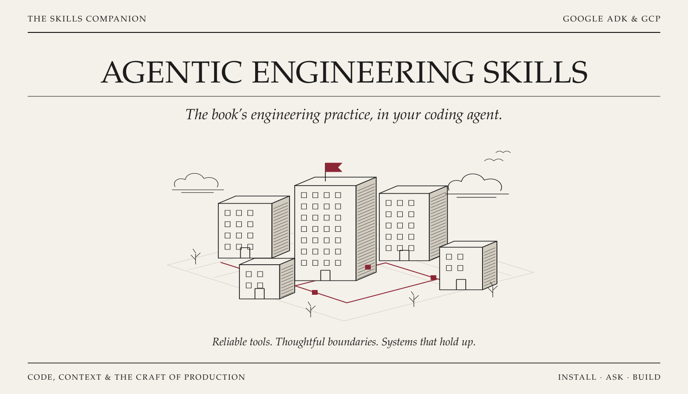
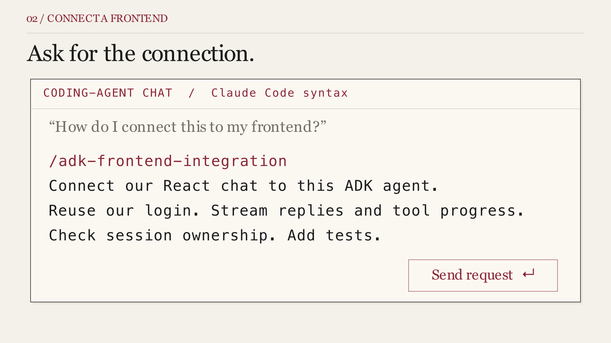

<p align="center">
  
</p>

<p align="center">
  <a href="#where-to-start">Where to start</a> ·
  <a href="#getting-started">Getting started</a> ·
  <a href="#the-skills">The skills</a> ·
  <a href="#using-skills-together">Using skills together</a> ·
  <a href="#compatibility--checks">What has been tested</a> ·
  <a href="#about-the-book">About the book</a>
</p>

# Agentic Engineering Skills

<p>
  <sub>
    <a href="https://github.com/google/adk-python">Google ADK</a> ·
    <a href="https://cloud.google.com/">Google Cloud</a> ·
    <a href="https://agentskills.io/">Agent Skills</a> ·
    <a href="LICENSE">MIT licensed</a>
  </sub>
</p>

Practical skills for building agent applications with Google's **Agent
Development Kit (ADK)** and **Google Cloud Platform (GCP)**. They accompany
**Agentic Engineering: Building Production-Grade Multi-Agent Systems with
Google ADK on GCP** by Ruslan Khissamiyev.

Let's connect on [LinkedIn](https://www.linkedin.com/in/ruslan-k-b6a48a1a6/).
Questions, feedback or ideas about the skills or the book? Feel free to write
to me at [khissamiyev@proton.me](mailto:khissamiyev@proton.me).

A **skill** is a folder of instructions, references and, where useful, helper
scripts that your coding agent can read while working on your project. These
skills help it apply the book's engineering practices to your own application:
handle failed tool calls, add memory, connect a browser interface, test agent
behaviour, or prepare a deployment.

## Where to start

| You are… | Start with | What you get back |
| --- | --- | --- |
| **Not sure where AI fits, or which use case comes first** | `/adk-discovery` | A short discovery conversation, a ranked list of opportunities with the technology each needs (agent, LLM, classical ML, rules or a process change), the first use case with its outcome measure and baseline, and the exact prompt for the designer |
| **Starting a new ADK application** | `/adk-system-designer` | A short design conversation, then an architecture document, a goal plan, and the exact prompt for the first goal |
| **Changing an application you already have** | `/adk-engineer` | It names the specialist it is using, makes the change with local tests, and says what is still unverified |
| **Presenting the work to decide the next step** | `/adk-presenter` | A slide outline with evidence under every claim, what to say, the questions to expect and a one-page decision memo, for a business or a technical audience, at proof-of-concept approval, production approval, results review, or as a public case study |

All four lead to the same nineteen specialists. You never need to remember which
one fits: the designer writes the specialist into every goal, and
`adk-engineer` picks one for any ticket or request. You can also call a
specialist directly when you already know the topic.
[Journey A](#journey-a-build-a-new-application),
[Journey B](#journey-b-maintain-an-application) and
[Journey C](#journey-c-win-the-decision) below show the prompts.

You do not need the book or its example repository to use the skills. Install
them in the project you want to work on. They guide your **coding agent**;
your application's ADK agents do not load them automatically.

<p align="center">
  
</p>

## Watch the Walkthrough

*Install. Ask. Review. · 2 minutes 20 seconds.*

Already have an ADK agent? See how to install the skills, ask for a streaming
frontend, and add a remembered language preference. This animated worked example
is backed by [runnable local code and checks](docs/video/skills-walkthrough/demo/README.md).

[](docs/video/skills-walkthrough/assets/walkthrough.mp4)

**[Watch or download the video — 2:20, MP4](docs/video/skills-walkthrough/assets/walkthrough.mp4)**

Music: “just turn it on and make something.” by
[hijaq.](https://hijaqmusic.bandcamp.com/track/just-turn-it-on-and-make-something),
used under the artist's published free-use permission.
[Full music credits](docs/video/skills-walkthrough/publishing.md#music-credits).

<p align="center">
  
</p>

## Getting Started

*Install the toolkit, open your project, and ask for a useful change.*

### 1. Install the skills

You need a coding agent that supports skills, Git, and Node.js **22.20 or later**
with npm, which provides `npx`. This is the current requirement of the
[Skills CLI](https://github.com/vercel-labs/skills/blob/main/package.json).
The installer downloads the skill files; it does not require Google Cloud
credentials or install ADK into your application.

From your application's project directory, run:

```bash
npx skills@latest add RuslanKhis/agentic-engineering-skills --skill '*'
```

Choose your coding agent when prompted. This installs **all twenty-three skills**
for the current project: `adk-discovery`, `adk-system-designer`,
`adk-engineer`, `adk-presenter`, the eleven chapter specialists, the web
backend specialist and the seven cross-framework specialists.
Keep the quotes around `'*'` so your shell passes it unchanged.

<details>
<summary>Choose a client explicitly, install globally, or select one specialist</summary>

**Choosing a Google client?** Use Antigravity for Google consumer accounts.
Since 18 June 2026, Gemini CLI no longer serves Code Assist for individuals,
Google AI Pro or Google AI Ultra through Google sign-in. Gemini CLI remains
available through Code Assist Standard/Enterprise and supported paid API-key
routes. See the [Google setup guide](docs/integrations/google-coding-agents.md),
[Google's account guidance](https://developers.google.com/gemini-code-assist/docs/deprecations/code-assist-individuals)
and [supported Gemini CLI access](https://developers.googleblog.com/en/an-important-update-transitioning-gemini-cli-to-antigravity-cli/).

To select a particular coding agent, use one of these project commands:

```bash
# Claude Code
npx skills@latest add RuslanKhis/agentic-engineering-skills --skill '*' -a claude-code

# Codex
npx skills@latest add RuslanKhis/agentic-engineering-skills --skill '*' -a codex

# Google Antigravity app or IDE
npx skills@latest add RuslanKhis/agentic-engineering-skills --skill '*' -a antigravity

# Google Antigravity CLI (agy)
npx skills@latest add RuslanKhis/agentic-engineering-skills --skill '*' -a antigravity-cli

# Gemini CLI with supported Standard/Enterprise or paid API-key access
npx skills@latest add RuslanKhis/agentic-engineering-skills --skill '*' -a gemini-cli
```

For Claude Code, Codex or Gemini CLI, add `-g` to install for your user account
across projects. For example:

```bash
npx skills@latest add RuslanKhis/agentic-engineering-skills --skill '*' -a codex -g
```

Antigravity's app, IDE and CLI document different global directories. Use the
project commands above or follow the [global directory guidance](docs/integrations/google-coding-agents.md#installation-scope)
for your client; the tested Skills CLI's `-g` destination differs from those paths.

If you already know the topic, install that specialist on its own:

```bash
npx skills@latest add RuslanKhis/agentic-engineering-skills --skill adk-memory-architecture
```

Each specialist includes its own references and helpers. Installing only
`adk-engineer` does not give you the specialists it needs to carry out the work.

To see the available skills without installing them:

```bash
npx skills@latest add RuslanKhis/agentic-engineering-skills --list
```

Leave out `--skill` for interactive skill selection. Other supported coding
agents can be selected in the installer; their invocation interface may differ.

</details>

### 2. Open your coding agent

Open your project after installation. If the coding agent was already running
and the new skills do not appear, restart its session. Type skill requests
**in the coding agent's chat**:

| Coding agent | New application | Existing application | A specialist directly |
| --- | --- | --- | --- |
| Claude Code | `/adk-system-designer` | `/adk-engineer` | `/adk-memory-architecture` |
| Codex | `$adk-system-designer` | `$adk-engineer` | `$adk-memory-architecture` |
| Antigravity app / IDE / CLI | `Use the adk-system-designer skill to…` | `Use the adk-engineer skill to…` | `Use the adk-memory-architecture skill to…` |
| Gemini CLI, with supported access | `Use the adk-system-designer skill to…` | `Use the adk-engineer skill to…` | `Use the adk-memory-architecture skill to…` |

The prompts in this README use Claude Code's `/` form. In Codex replace the
leading `/` with `$`; in Gemini CLI or Antigravity say "Use the <skill> skill
to…" and keep the rest of the request.

<details>
<summary>How skill activation differs between clients</summary>

Claude Code supports `/name` for installed skills; Codex supports explicit
skill mentions using `$name`. See the respective
[Claude Code](https://code.claude.com/docs/en/skills) and
[Codex](https://developers.openai.com/codex/skills/) documentation.

Gemini CLI activates skills in response to the request; use `/skills list` to
check discovery and `/skills reload` after changes. Installing these skills
does not create `/adk-engineer` as a Gemini CLI command. Antigravity 2.0 and its
CLI also support named skill commands such as `/adk-engineer`; mentioning the
skill by name works across its app, IDE and CLI interfaces. Follow any
activation prompt the client shows.
[Gemini skill usage](https://geminicli.com/docs/cli/using-agent-skills/),
[Antigravity invocation](https://www.antigravity.google/docs/migration/workflows-to-skills/).

No separate setup command is needed for this toolkit. The skills inspect the
project's existing code and configuration when they run. Their descriptions also
allow a supporting coding agent to select them from a natural-language request;
an explicit command makes your intended skill clear.

</details>

### Journey A: build a new application

**0. Find the use case first, if nobody has chosen one.** Skip this when you
already know what to build. Otherwise the discovery skill asks what the
business does and where its journey breaks, ranks the opportunities, says
which need an agent and which need classical ML, rules or a process change,
and ends with the designer's prompt:

```text
/adk-discovery Leadership wants AI in <area> but has not said where. Help me
find where it would pay off, which workflow to improve first, what outcome we
would measure, and whether an agent is even the right tool. Save the brief.
```

It saves `docs/discovery/<topic>.md`. The designer reads that brief as
answered scope and does not reopen the choice.

**1. Design it in conversation.** The designer asks only what changes the
design, offers defaults you can accept in one word, turns each requirement
into contracts the system must keep, and explains each choice as the contract
it enforces, its tradeoff and how to check it.

```text
/adk-system-designer I want to build <one-sentence product> with ADK on GCP.
I have <time and budget>; <who> will judge it as an <exploration, assignment,
pilot or production service>. Design only.
```

It first asks how much time, how many people and how much money there are,
who will use or judge the result, and what data it touches. A five-hour demo,
an internal tool for colleagues and a regulated production service get
different designs: it says which concerns are built now, which stay minimal
and which wait, and keeps a small safety floor even in a proof of concept.
When the application has its own web interface, it also asks who can reach the
URL and whether other developers will continue it. It then applies its web
defaults (a Vite and React app served by one FastAPI service, styled from the
house design system), names the companion skills each goal loads (FastAPI's
own skill, shadcn, Vercel's React rules, Playwright) with their pins, and
assigns its web security baseline: rules tagged with OWASP identifiers,
recorded once in the design with what proves each one or what defers it.

It saves `docs/architecture/<topic>.md` and `docs/plans/<topic>.md`, and ends
with the prompt for the first goal. The plan is split into phases: phase 1
fits the hours you have, phase 2 hardens or graduates it, and a later list
keeps each deferred item with what would bring it forward, so you can ship
first and continue when there is time. Every goal names its primary and
supporting specialists, an estimate of the human hours it needs when working
with a coding agent (hands-on time plus reviewing and verifying the change,
with waits such as security reviews listed separately), and its own run prompt.

**2. Optionally turn goals into tickets.** One file per goal, for a tracker or
for parallel sessions:

```text
/adk-system-designer Turn the ready goals in docs/plans/<topic>.md into
ticket files under docs/tickets/<topic>/.
```

**3. Build, one goal or ticket at a time.**

```text
/adk-engineer Carry out G01 from docs/plans/<topic>.md.
```

```text
/adk-engineer Continue the next ready goal in docs/plans/<topic>.md.
```

Each run names the specialist it applies, loads the goal's companion skills at
the pins in the project's `AGENTS.md` (or says how to install a missing one),
verifies the goal's acceptance cases locally, records the evidence in the plan
or ticket, one line per contract and security rule, and ends with the prompt
for the next one. Nothing is deployed or paid for without your approval.

### Journey C: win the decision

A project is presented four times: to get the go-ahead for the proof of
concept, to show what the proof of concept did and win the production
decision, to show what the production build delivered, and, when the result
is shareable, as a public case study. The designer asks which of these
reviews the project needs and writes each as a goal in the plan (and a
ticket, if you ask for tickets), one per audience. The presenter builds each
from the evidence the goals recorded, never from a number it made up:

```text
/adk-presenter Prepare the proof-of-concept approval presentation for a
business audience from docs/discovery/<topic>.md, docs/architecture/<topic>.md
and docs/plans/<topic>.md. Fifteen minutes. Then a technical version for the
platform team.
```

```text
/adk-presenter The proof of concept is done and its evidence is in
docs/plans/<topic>.md. Prepare the production-approval presentation for
leadership and the questions they will ask; label anything unmeasured as a
hypothesis.
```

```text
/adk-presenter All production goals in docs/plans/<topic>.md are complete
with evidence. Prepare the final results presentation for the sponsor and
the leadership team: outcome against the baseline, adoption, cost, incidents
and what comes next. Then the technical handover version for the platform
team that runs it.
```

```text
/adk-presenter Draft a public case study from the production results in
docs/plans/<topic>.md, with the approvals and numbers we must gather before
sharing it with our Google Cloud account team.
```

Expect one outline per audience under `docs/presentations/<topic>/`, with
the speech written out as speaker notes in the same file, a one-page
decision memo, and a deck check that fails when a slide carries a number
without a source. The discovery skill offers the first of these prompts
when it finishes, so the approval deck can be drafted from the brief before
the design exists.

### Journey B: maintain an application

Hand `adk-engineer` a ticket, a symptom or a change. It reads the project,
tells you which specialist it is using and why, then does the work.

```text
/adk-engineer Carry out tickets/T-101.md.
```

```text
/adk-engineer Our agent picks the wrong tool for order lookups and passes the
customer's name where the order ID goes. Fix it and add a regression test.
```

```text
/adk-engineer Google says our Gemini model retires next month. Plan and make
the upgrade without silently dropping quality.
```

```text
/adk-engineer Which specialist should handle this, and why? Do not change
code yet: <paste the issue>
```

For implementation work, expect a project change, the checks that actually ran
and a clear account of what remains unverified. Find **three examples for every
skill** in the catalogue below, and installation fixes under
[updating and troubleshooting](#updating-and-troubleshooting).

<p align="center">
  
</p>

## The Skills

*The contents · A discovery skill, a system designer, one entry point, a presenter, eleven chapter specialists, a web backend specialist and seven cross-framework specialists.*

Choose a skill by the problem you need to solve. Each entry below explains
when it helps, what to ask for, and the command that selects it. The numbered
specialists follow Chapters 0–10 of the book; no chapter reading is required.

| What you need | Skill |
| --- | --- |
| Where AI fits, which use case first, what to measure, whether an agent, classical ML, rules or a process change is the right tool, and the countermeasures for the reasons AI projects stall | [adk-discovery](#adk-discovery) |
| A system-design conversation and architecture before implementation | [adk-system-designer](#adk-system-designer) |
| Help choosing an approach or combining concerns | [adk-engineer](#adk-engineer) |
| A presentation for a proof-of-concept approval, a production decision, a results review or a public case study | [adk-presenter](#adk-presenter) |
| Sequential steps, parallel work or bounded loops | [adk-workflow-design](#adk-workflow-design) |
| Reliable API calls and protection against duplicate actions | [safe-api-tool-calls](#safe-api-tool-calls) |
| Usage limits, repeated-tool protection or human approval | [adk-operational-guardrails](#adk-operational-guardrails) |
| A hosting choice or deployment preparation | [deploy-adk-on-google-cloud](#deploy-adk-on-google-cloud) |
| Faster replies and lower model usage | [optimise-adk-on-google-cloud](#optimise-adk-on-google-cloud) |
| A browser interface, streaming or tool progress, its design system and agent UI states | [adk-frontend-integration](#adk-frontend-integration) |
| The web backend around the agent: sign-in check, own-record routes, migrations beside ADK's tables, API contract and typed client | [adk-fastapi-backend](#adk-fastapi-backend) |
| Conversation history, memory or document retrieval | [adk-memory-architecture](#adk-memory-architecture) |
| Repeatable tests and trustworthy evaluation results | [adk-agent-evaluation](#adk-agent-evaluation) |
| Sensitive-data controls across prompts, tools and replies | [protect-adk-sensitive-data](#protect-adk-sensitive-data) |
| Tool identity, credentials or per-user OAuth | [adk-tool-auth-and-secrets](#adk-tool-auth-and-secrets) |
| Controlled natural-language analytics and SQL execution | [adk-sql-agent-engineering](#adk-sql-agent-engineering) |
| Agent instructions, state templating and sub-agent descriptions | [adk-agent-instructions](#adk-agent-instructions) |
| Tool docstrings, parameter schemas, tool count and result shape | [adk-tool-interface-design](#adk-tool-interface-design) |
| Structured output, model choice, thinking settings and failover | [adk-model-and-output-contracts](#adk-model-and-output-contracts) |
| Prompt-injection resilience, MCP vetting, sandboxing and red-teaming | [adk-agent-security](#adk-agent-security) |
| Tracing, metrics, SLOs, alerts and production-to-evaluation hand-off | [adk-agent-observability](#adk-agent-observability) |
| Version pinning, CI eval gates, model migration, canary and rollback | [adk-release-engineering](#adk-release-engineering) |
| MCP servers, remote A2A agents, agent cards and registration | [adk-agent-interoperability](#adk-agent-interoperability) |

**Copy any example into your coding agent's chat.** Examples use Claude Code's
`/` prefix. In Codex, replace only the leading `/` with `$`; keep the skill name
and request the same. In Gemini CLI or an Antigravity IDE integration, replace
`/skill-name` with “Use the skill-name skill to” and keep the request.
Antigravity 2.0 and its CLI also support the slash form. Adapt the scenario to your project.

### [adk-discovery](skills/adk-discovery/SKILL.md)

*Before design · Find where AI pays off and pick the first use case.*

Use this when a company wants "AI" but has not said where, or has only a rough
area in mind. It works in two entry modes. With a rough area, it finds where
the current journey breaks (which step people abandon, re-key or wait on),
picks the first workflow to improve and the business outcome to measure, with
its baseline. With no use case at all, it asks what the business does, which
KPIs matter and which processes drive them, then proposes where AI, ordinary
automation or a process change would make a difference. Every opportunity gets
a technology fit: an agent, a single LLM call, classical machine learning,
rules or scripting, or no software at all, with the reason in a sentence a
stakeholder can repeat. It records the hypothesis chain and a counter-metric,
ranks the portfolio with a small helper so the arithmetic is not done in the
model's head, and checks the brief against the thirteen reasons AI projects
stall for reasons other than the model (a misframed problem, no baseline, an
unchanged workflow, no senior owner, no human-validation point, inaccessible
data, unmodelled cost, missing risk controls, ignored training, no feedback
loop, a pilot never embedded, build-or-buy on pride, model churn), each with
the field that answers it. It saves `docs/discovery/<topic>.md`, ends with
the exact `adk-system-designer` prompt, and offers to draft the
proof-of-concept approval presentation from the brief. It does not write contracts, architecture or
goals; that is the designer's job, and the designer does not reopen the
choice.

**Invoke:** Claude Code `/adk-discovery` · Codex `$adk-discovery`

Gemini CLI / Antigravity: "Use the adk-discovery skill to…"

<details>
<summary>Three practical examples</summary>

```text
/adk-discovery We sell advertising to small businesses and leadership wants
to use AI to sell more easily, but nobody has said where. Ask me about the
buying journey, find where advertisers drop out, and tell me which workflow
to improve first and what we would measure.
```

```text
/adk-discovery I run a regional logistics firm and do not know how AI agents
work or where they would help. Ask me about the business, its numbers and
its processes, then tell me where AI, plain automation or a process change
would pay off, and what to try first.
```

```text
/adk-discovery Here are five ideas our teams proposed for AI. Score them on
value, feasibility, data readiness and risk, say which need an agent and
which are really classical ML or a script, and write the brief for the one
we should start with.
```

</details>

### [adk-engineer](skills/adk-engineer/SKILL.md)

*Start here · Choose the right specialist.*

Use this when you can describe the outcome but are unsure which skill fits.
It inspects your project, selects the relevant installed specialist, and follows
that skill through the requested explanation, design, code change or review.
It can combine specialists when a change crosses several concerns, and loads
their instructions as needed.

**Invoke:** Claude Code `/adk-engineer` · Codex `$adk-engineer`

Gemini CLI / Antigravity: “Use the adk-engineer skill to…”

<details>
<summary>Three practical examples</summary>

```text
/adk-engineer Add memory so our support agent remembers a user's preferred
language between conversations. Use our existing database and let users
change or forget the preference.
```

```text
/adk-engineer Our agent sometimes issues a refund twice after a timeout.
Trace the tool call, fix the cause and add a regression test.
```

```text
/adk-engineer We have a working Python ADK agent and an existing React app.
Plan how to connect them with streamed replies and private user sessions.
Identify the code and tests we will need.
```

</details>

### [adk-system-designer](skills/adk-system-designer/SKILL.md)

*Design first · Work out what the application must guarantee.*

Use this to design a new ADK/GCP application, rethink an existing architecture,
or review decisions that span several parts of the system. It asks a few useful
questions at a time, explains trade-offs and helps choose the smallest architecture
that meets your requirements.

It sizes the design to the team: a proof of concept, an internal tool, an MVP
and a production service each get a different depth per concern, a capacity
check against the people and hours available, and a phased plan with a cut
line you confirm.

It works through **requirement → contract → design choice → reason →
tradeoff → verification → evidence**. A requirement is what you need
("advertisers can buy campaigns"). A contract is a precise, observable promise
derived from it ("one confirmed purchase creates at most one order"). One
requirement usually splits into several contracts: here a quote, a
confirmation bound to the exact order, the purchase operation and the status
shown from real receipts. Each contract is numbered and records its invariant,
scope, authoritative source, where it is enforced (and checked again before the
effect), the failure outcome and its evidence. Decisions cite the contracts
they enforce, goals cite the contracts they prove, and `adk-engineer` records
evidence against each one, so you can always answer "what proves C3?". A
read-only demo needs a handful of contracts; money, orders or publishing need
more. When your answers change a requirement, it revises the affected
contracts and the choices, goals and checks that depend on them.

The result is a system design with component and request-flow diagrams where
useful, data ownership, identity and tool permissions, failure recovery, latency
and cost assumptions, plus an implementation plan. Each important choice includes
an ADK or application component, its GCP responsibility and the skill that can
help implement it. Goals record dependencies, acceptance checks, blockers and a
prompt for continuing the work in another session. Decisions and open questions
stay explicit. A focused request such as “add memory” still belongs with the
memory specialist.

The usual artifacts are `docs/architecture/<topic>.md` and
`docs/plans/<topic>.md`, adapted to your project. A small plan can stay in the
design document. See the [copyable design-to-tickets walkthrough](#from-design-to-working-tickets)
and [guide to continuing the work](docs/integrations/design-to-implementation.md).

**Invoke:** Claude Code `/adk-system-designer` · Codex `$adk-system-designer`

Gemini CLI / Antigravity: “Use the adk-system-designer skill to…”

<details>
<summary>Three practical examples</summary>

```text
/adk-system-designer I want a customer-support agent using ADK and GCP.
It should explain case status and create escalations. Talk me through
the requirements and trade-offs, then write the architecture before we code.
```

```text
/adk-system-designer We already have React, OIDC login and PostgreSQL.
Help design an ADK assistant that can request refunds. Work through user
permissions, approval, duplicate requests, recovery and cost controls.
Keep our existing stack and capture the decisions in docs/architecture/.
```

```text
/adk-system-designer Review our proposed multi-agent architecture on GCP.
Trace a successful request, a denied user, a lost tool response and a worker
restart. Identify unnecessary components and gaps in our guarantees.
Give us a revised design and acceptance plan; do not implement it yet.
```

</details>

### [adk-presenter](skills/adk-presenter/SKILL.md)

*At every decision · Show the value, with evidence under every claim.*

Use this when the work must be presented to the people who decide what
happens next: approval to build a proof of concept, a review of that proof of
concept with a production decision, a final results review, or a public case
study to share with Google or the wider world. For each stage it prepares two
versions, one for business decision-makers (the decision requested, results
against the criteria agreed in advance, cost, risk, options) and one for the
technical teams who will inherit the system (architecture, contracts,
evidence, operations, handover). It reads the discovery brief, the design and
the plan, takes every number from recorded evidence, labels anything
unmeasured as a hypothesis, and writes a slide outline with an action title
and an evidence citation per slide, the speech itself as speaker notes
(bottom line first, one real case, three reasons, what did not work and the
answer, options and the decider, with timings per stage), the questions to
expect with a protocol for answering them, and a one-page decision memo.
Its slide-craft reference turns the outline into assertion-evidence slides:
one claim, one visual, the baseline drawn, a caption with sample and method.
A helper checks the outline: a number without a source, a slide without
evidence, or a missing stage topic fails the check; hype words, over-long
titles or bodies, and notes that overrun the minutes are warned. The
designer plans these presentations as goals at each phase boundary.

**Invoke:** Claude Code `/adk-presenter` · Codex `$adk-presenter`

Gemini CLI / Antigravity: "Use the adk-presenter skill to…"

<details>
<summary>Three practical examples</summary>

```text
/adk-presenter We need leadership's approval for a four-week proof of
concept. Build the business presentation from docs/discovery/ads.md and
docs/plans/ads.md: the problem, the hypothesis, the success criteria we
will be judged on, cost, risks and the decision we are asking for.
```

```text
/adk-presenter The proof of concept is finished and its evidence is in
docs/plans/ads.md. Prepare the production-approval presentation for
leadership and a separate technical one for the platform team, with the
questions each will ask. Two acceptance cases were never run; say so.
```

```text
/adk-presenter The agent has run in production for a quarter with measured
results in docs/plans/ads.md. Draft the final results presentation and a
public case study, and list the approvals and numbers we need before
sharing it with our Google Cloud account team.
```

</details>

### I. Foundations & safeguards

*Give the system a structure, then give it boundaries.*

#### [adk-workflow-design](skills/adk-workflow-design/SKILL.md)

*00 · Arrange the work and make sure it finishes.*

Use this to decide which steps run in order, which can run together, and when
a refinement loop should stop. It helps implement or repair the handoffs
between agents, shared state and final results. Ask for a workflow design,
a focused code change, or tests that show each step produces the required output.

**Invoke:** Claude Code `/adk-workflow-design` · Codex `$adk-workflow-design`

Gemini CLI / Antigravity: “Use the adk-workflow-design skill to…”

<details>
<summary>Three practical examples</summary>

```text
/adk-workflow-design Build a workflow that researches a topic, drafts an
answer, then checks it. Pass each step's result to the next and test what
happens when the research step fails.
```

```text
/adk-workflow-design Our agent fetches a customer's orders and support
tickets one after the other. Run these independent lookups in parallel,
then combine both results without losing either one.
```

```text
/adk-workflow-design Our writer and reviewer keep revising forever.
Limit them to three revision rounds and return an explicit result when
the reviewer still rejects the draft.
```

</details>

#### [safe-api-tool-calls](skills/safe-api-tool-calls/SKILL.md)

*01 · Handle unreliable APIs without repeating an action by accident.*

Use this when a tool calls an external service that can fail, hang or return
an unclear result. It helps add selective retries, time limits and protection
against duplicate writes where the provider supports it. The result should
include tests for failures and an honest response when an action's outcome
cannot yet be confirmed.

**Invoke:** Claude Code `/safe-api-tool-calls` · Codex `$safe-api-tool-calls`

Gemini CLI / Antigravity: “Use the safe-api-tool-calls skill to…”

<details>
<summary>Three practical examples</summary>

```text
/safe-api-tool-calls Our order lookup fails on occasional 429 and 503
responses. Add retries for recoverable failures, respect Retry-After,
and keep the complete lookup within a five-second budget.
```

```text
/safe-api-tool-calls This refund tool retries after a timeout and can
refund twice. Inspect the provider's duplicate-request guarantees and
fix the tool to preserve one logical refund across supported retries.
```

```text
/safe-api-tool-calls The booking API may accept a reservation before our
connection drops. Add an uncertain-result path and a status check so
the agent does not blindly submit another booking.
```

</details>

#### [adk-operational-guardrails](skills/adk-operational-guardrails/SKILL.md)

*02 · Put limits and approval checks around agent actions.*

Use this when an agent repeats tools, consumes too much model usage, runs too
long, or needs a person to approve an action. It helps put enforcement in the
application code that actually runs the work, with tests showing that blocked
actions never execute. It also helps design usage accounting across turns
and application controls for reducing spend.

**Invoke:** Claude Code `/adk-operational-guardrails` · Codex `$adk-operational-guardrails`

Gemini CLI / Antigravity: “Use the adk-operational-guardrails skill to…”

<details>
<summary>Three practical examples</summary>

```text
/adk-operational-guardrails Our agent keeps calling the same failing tool.
Stop repeated calls with identical arguments, cap model calls at ten per
request, and test that blocked calls never reach the tool.
```

```text
/adk-operational-guardrails Add a token allowance that accumulates across
a user's conversation. Refuse further model work when it is exhausted
and return a clear message without another model call.
```

```text
/adk-operational-guardrails Require human approval before the agent
cancels an order. Bind approval to that specific cancellation and test
rejection, repeated approval and attempted execution before approval.
```

</details>

### II. From runtime to interface

*Find a home for the agent, refine its performance, and open the conversation.*

#### [deploy-adk-on-google-cloud](skills/deploy-adk-on-google-cloud/SKILL.md)

*03 · Choose a host and prepare the files needed to run there.*

Use this to compare Cloud Run, managed Agent Runtime and Google Kubernetes
Engine (GKE), or adapt an existing project for your chosen host. It helps
prepare packaging, runtime identity, configuration, health checks and
verification steps. You can request a recommendation or locally checked
deployment files before doing any cloud deployment.

**Invoke:** Claude Code `/deploy-adk-on-google-cloud` · Codex `$deploy-adk-on-google-cloud`

Gemini CLI / Antigravity: “Use the deploy-adk-on-google-cloud skill to…”

<details>
<summary>Three practical examples</summary>

```text
/deploy-adk-on-google-cloud We have an ADK agent behind a custom FastAPI
service and no Kubernetes platform. Compare Cloud Run and Agent Runtime
for our project and recommend a host with a concrete deployment plan.
```

```text
/deploy-adk-on-google-cloud Prepare this existing API for Cloud Run.
Add the container configuration, a health check and a deployment runbook.
Validate locally and leave cloud deployment for later.
```

```text
/deploy-adk-on-google-cloud Review our agent's GKE manifests. Check the
runtime identity, startup and readiness probes, configuration and session
storage. Report specific changes with verification steps.
```

</details>

#### [optimise-adk-on-google-cloud](skills/optimise-adk-on-google-cloud/SKILL.md)

*04 · Find where time and model usage go before changing the system.*

Use this for slow replies, growing token usage, startup delays or problems
under concurrent load. It traces the request through tools, model calls,
session storage and hosting, then targets a measured bottleneck. Expect a
focused improvement with a comparison plan, or instrumentation and hypotheses
when the project has no measurements yet.

**Invoke:** Claude Code `/optimise-adk-on-google-cloud` · Codex `$optimise-adk-on-google-cloud`

Gemini CLI / Antigravity: “Use the optimise-adk-on-google-cloud skill to…”

<details>
<summary>Three practical examples</summary>

```text
/optimise-adk-on-google-cloud Our replies take about twelve seconds.
Add timing around model calls, tools and session storage so we can locate
the delay, and show how to compare requests consistently.
```

```text
/optimise-adk-on-google-cloud Token usage grows on every turn because we
keep passing full tool results and conversation history. Inspect what
the model needs, reduce avoidable context and test answer completeness.
```

```text
/optimise-adk-on-google-cloud This Cloud Run service is slow on the first
request and under concurrent load. Review our startup path, configuration
and supplied traces, then propose changes with a measurement plan.
```

</details>

#### [adk-frontend-integration](skills/adk-frontend-integration/SKILL.md)

*05 · Connect the agent to the person using it.*

Use this to connect an existing browser interface to an ADK agent through a
JSON API or a streaming interface using AG-UI and CopilotKit. It helps define
requests and responses, connect conversations to authenticated users, and
display text, tool progress and failures correctly. It also sets up a new
interface's look from a house design system (a restrained enterprise theme in
Google's DESIGN.md format, never shadcn's default) and the agent's UI states:
tool timeline, approvals, citations and a turn that fails after a partial
answer. Ask for a working integration, an interface design, or a repair to the
conversation flow.

**Invoke:** Claude Code `/adk-frontend-integration` · Codex `$adk-frontend-integration`

Gemini CLI / Antigravity: “Use the adk-frontend-integration skill to…”

<details>
<summary>Three practical examples</summary>

```text
/adk-frontend-integration Connect our existing React chat to this ADK
agent through a JSON API. Reuse our login system and ensure users can
only create and continue their own conversations.
```

```text
/adk-frontend-integration Add streaming replies and tool-progress cards
to our existing CopilotKit interface using AG-UI. Check our pinned
versions and test one complete request through the browser.
```

```text
/adk-frontend-integration Our chat shows duplicate text when a final
answer arrives, and errors after partial text look like success.
Fix both cases and add tests for the actual event sequence.
```

</details>

#### [adk-fastapi-backend](skills/adk-fastapi-backend/SKILL.md)

*Build the ordinary web backend around the agent, safely.*

Use this for the HTTP application around an ADK agent: where the Runner runs,
one sign-in check that every `/api` route shares and that refuses requests
when no verifier is configured, routes that only return the caller's own
records, application tables and migrations kept apart from ADK's session
tables, the public API contract and the typed client generated from it,
errors, CORS, security headers and the single-process Cloud Run shape. FastAPI
syntax comes from FastAPI's own skill; this one covers where ADK and Google
Cloud change the answer, such as ADK's own server having no authentication.

**Invoke:** Claude Code `/adk-fastapi-backend` · Codex `$adk-fastapi-backend`

Gemini CLI / Antigravity: “Use the adk-fastapi-backend skill to…”

<details>
<summary>Three practical examples</summary>

```text
/adk-fastapi-backend Add endpoints so users can list and delete the
documents they uploaded to our ADK assistant, with two-user tests.
```

```text
/adk-fastapi-backend Set up Alembic migrations for our app tables; the
agent's sessions already live in the same Postgres.
```

```text
/adk-fastapi-backend Generate a typed TypeScript client for our React app
from this backend and fail make check when it drifts.
```

</details>

### III. Memory, evidence & care

*Decide what the system knows, how to test it, and what it must protect.*

#### [adk-memory-architecture](skills/adk-memory-architecture/SKILL.md)

*06 · Remember the right information for the right person.*

Use this when an agent needs to continue a conversation, remember facts across
sessions, answer from approved documents, or look up structured history. It
helps choose the right store and connect it to the agent, with explicit rules
for who can read the data, how long it stays and how it is forgotten. Exact
settings, such as a preferred language, may belong in an ordinary profile record.

**Invoke:** Claude Code `/adk-memory-architecture` · Codex `$adk-memory-architecture`

Gemini CLI / Antigravity: “Use the adk-memory-architecture skill to…”

<details>
<summary>Three practical examples</summary>

```text
/adk-memory-architecture Let users resume a conversation after the
server restarts. Use our existing database, enforce conversation
ownership and test that one user cannot load another user's history.
```

```text
/adk-memory-architecture Help our agent answer questions from approved
company manuals. Design document retrieval with source references,
document-version controls and access checks for each user.
```

```text
/adk-memory-architecture Add opt-in memory for low-risk facts users
share across sessions. Include correction, expiry and a forget action,
with offline tests for consent denial and cross-user access.
```

</details>

#### [adk-agent-evaluation](skills/adk-agent-evaluation/SKILL.md)

*07 · Test what the agent does as well as what it says.*

Use this to catch regressions in tool selection, arguments, action order,
stored effects and final answers. It helps write repeatable tests with a
scripted model, prepare evaluation cases for a real model, or audit a report
whose passing scores may hide missing checks. The output is a test strategy,
executable tests, evaluation assets or evidence-backed findings.

**Invoke:** Claude Code `/adk-agent-evaluation` · Codex `$adk-agent-evaluation`

Gemini CLI / Antigravity: “Use the adk-agent-evaluation skill to…”

<details>
<summary>Three practical examples</summary>

```text
/adk-agent-evaluation Add deterministic tests through our ADK runner
that force an invalid refund request. Assert that the refund tool
rejects it and no money-changing operation reaches the backend.
```

```text
/adk-agent-evaluation Create evaluation cases for a support agent that
must look up an order before cancelling it. Cover missing details,
refusal and successful cancellation. Validate the files offline.
```

```text
/adk-agent-evaluation Our evaluation report says every case passed,
but some tool failures were ignored. Audit the result files for missing
cases, failed actions and answers that falsely claim success.
```

</details>

#### [protect-adk-sensitive-data](skills/protect-adk-sensitive-data/SKILL.md)

*08 · Control what sensitive information reaches each part of the system.*

Use this when personal information or credentials could enter prompts, tools,
conversation history, logs or public replies. It helps implement or review
screening and data-handling rules, including Google Sensitive Data Protection
and Model Armor integrations. Ask for a traced data flow, a focused code
change and tests showing what happens when screening rejects data or fails.

**Invoke:** Claude Code `/protect-adk-sensitive-data` · Codex `$protect-adk-sensitive-data`

Gemini CLI / Antigravity: “Use the protect-adk-sensitive-data skill to…”

<details>
<summary>Three practical examples</summary>

```text
/protect-adk-sensitive-data Add a Sensitive Data Protection boundary
that replaces email addresses and rejects credentials before text is
saved or sent to the model. Test failures with a fake screening client.
```

```text
/protect-adk-sensitive-data Review this agent for customer data leaking
through tool results, session history, logs or traces. Map each path
and recommend specific fixes with regression cases.
```

```text
/protect-adk-sensitive-data Our API streams answers before screening
finishes. Buffer the answer, apply the configured Model Armor checks,
and test that blocked or uninspectable content is never released.
```

</details>

### IV. Trust in practice

*Secure the boundaries and work through a case study.*

#### [adk-tool-auth-and-secrets](skills/adk-tool-auth-and-secrets/SKILL.md)

*09 · Give each tool the right identity and keep credentials out of the conversation.*

Use this when tools need private Google Cloud access, an application secret,
or permission to act through a user's connected account. It helps separate
the authenticated user from the service's credentials, enforce access in
trusted code, and handle OAuth connection, refresh and disconnect flows.
Expect an implementation or review with tests for user isolation and
credential exposure.

**Invoke:** Claude Code `/adk-tool-auth-and-secrets` · Codex `$adk-tool-auth-and-secrets`

Gemini CLI / Antigravity: “Use the adk-tool-auth-and-secrets skill to…”

<details>
<summary>Three practical examples</summary>

```text
/adk-tool-auth-and-secrets Our tool loads a service-account key file.
Adapt it for keyless Google Cloud credentials and document the narrow
runtime permissions it needs. Keep IAM changes as a reviewable plan.
```

```text
/adk-tool-auth-and-secrets Move our third-party API key out of agent
state and load it from Secret Manager in trusted code. Test that tool
results, errors and session events do not expose the key.
```

```text
/adk-tool-auth-and-secrets Add a per-user OAuth connection for our
calendar tool, including refresh and disconnect. Test locally that
one user's session cannot select or use another user's credentials.
```

</details>

#### [adk-sql-agent-engineering](skills/adk-sql-agent-engineering/SKILL.md)

*10 · Turn business questions into controlled, read-only analytics.*

Use this to build or improve an agent that answers questions from a database.
It helps route familiar questions to reviewed SQL templates, give the model
only relevant authorised schema information, and check proposed queries in
application code before execution. Expect a small working query path, tests
for correct answers and rejected queries, or an architecture review.

**Invoke:** Claude Code `/adk-sql-agent-engineering` · Codex `$adk-sql-agent-engineering`

Gemini CLI / Antigravity: “Use the adk-sql-agent-engineering skill to…”

<details>
<summary>Three practical examples</summary>

```text
/adk-sql-agent-engineering Add a path for "What were monthly sales last
quarter?" using our approved revenue definition and a parameterised SQL
template. Test the totals and reject unsupported filters.
```

```text
/adk-sql-agent-engineering Our agent sends all 500 table schemas to the
model for every question. Retrieve only relevant authorised schemas
and test that unrelated or forbidden tables never enter its context.
```

```text
/adk-sql-agent-engineering Review our generated-query execution path.
Enforce read-only queries, allowed tables and resource limits in code,
and add tests proving rejected queries never reach the database.
```

</details>

### V. Cross-framework practices

*What the model sees and emits · Practices from across the field, implemented for ADK.*

These seven specialists did not come from a book chapter. They came from a
review of current AI-engineering practice (vendor guidance from Google,
Anthropic and OpenAI, independent studies, the official ADK documentation,
Google's samples and the ADK issue tracker) against what the toolkit already
covered. The first three own what the model sees and emits: the instruction
text, the tool declarations and the output contract. The next three own the
production lifecycle: the agent's security posture, its telemetry, and its
releases. The last owns the process boundary: MCP servers and A2A peers. Their
mechanics were checked against the google-adk 2.8.0 source and
the later changelog; see the
[gap review](docs/research/ai-engineering-practices-gap-review.md).

#### [adk-agent-instructions](skills/adk-agent-instructions/SKILL.md)

*Write the instruction that carries the judgment, and keep it owned and tested.*

Use this when an agent follows its prompt poorly, calls tools too eagerly or
not at all, routes requests to the wrong sub-agent, or raises a templating
error on a placeholder. It covers instruction structure and altitude, ADK
session-state templating, tool-use guidance inside the prompt, sub-agent
descriptions as routing contracts, few-shot exemplars, the division between
prompt and code, model-generation notes and a prompt-as-code layout with a
contract test. A read-only linter reports unresolved placeholders, literal
braces, shouting modifiers, mandated tool calls and near-duplicate sibling
descriptions. The measured improvement loop stays with
[adk-agent-evaluation](#adk-agent-evaluation).

**Invoke:** Claude Code `/adk-agent-instructions` · Codex `$adk-agent-instructions`

Gemini CLI / Antigravity: “Use the adk-agent-instructions skill to…”

<details>
<summary>Three practical examples</summary>

```text
/adk-agent-instructions Our coordinator keeps sending refund questions to
the billing agent instead of the refunds agent. Fix the sub-agent
descriptions and the root instruction, and show me the request the
model actually receives.
```

```text
/adk-agent-instructions Rewrite the system instruction for our Gemini 3
support agent. It is 1,800 words of MUST and NEVER rules, calls search on
every turn and nobody can review changes to it.
```

```text
/adk-agent-instructions Add a {customer_tier} placeholder and a JSON
output example to this agent's instruction without breaking state
templating on our pinned ADK, and give me a test that catches regressions.
```

</details>

#### [adk-tool-interface-design](skills/adk-tool-interface-design/SKILL.md)

*Design the tool the way the model will see it.*

Use this when the model picks the wrong tool or fills parameters wrongly, when
tool results flood the context, or when a new tool, toolset or MCP server needs
a model-facing schema. It covers FunctionTool docstrings and parameter rules
for the pinned ADK, naming and consolidation, tool-count budgets and dynamic
toolsets, result shaping and size, actionable error returns, and the choice
between AgentTool, sub-agents and single-turn mode. A read-only linter checks
declarations and a second helper measures tool-result sizes from recorded
events. Retries and idempotency of the external call stay with
[safe-api-tool-calls](#safe-api-tool-calls).

**Invoke:** Claude Code `/adk-tool-interface-design` · Codex `$adk-tool-interface-design`

Gemini CLI / Antigravity: “Use the adk-tool-interface-design skill to…”

<details>
<summary>Three practical examples</summary>

```text
/adk-tool-interface-design Our agent keeps calling search_orders when it
should call get_order, and sometimes passes the customer name where the
order ID goes. Review the tool declarations and fix what the model sees.
```

```text
/adk-tool-interface-design We are adding a 40-tool MCP server. Help us
decide which tools to expose, how to name and filter them, and whether to
load them dynamically.
```

```text
/adk-tool-interface-design Write the docstrings, return shapes and error
messages for three new BigQuery lookup tools so Gemini uses them
reliably, and tell me how to check it.
```

</details>

#### [adk-model-and-output-contracts](skills/adk-model-and-output-contracts/SKILL.md)

*Decide what the model emits, which model emits it, and how code proves it.*

Use this when structured output arrives as prose, fenced JSON or invalid data,
when a response schema needs designing within Gemini's limits, when a model
must be chosen or escalated, or when thinking, temperature or failover settings
need to change. It covers output_schema contracts and their validation path on
the pinned ADK, repair loops with an attempt budget, output_schema together
with tools on each backend, current Gemini model IDs and lifecycle dates,
thinking_level and sampling rules for Gemini 3, and FallbackModel. Two helpers
check a response schema against the documented Gemini subset and audit a
project's model configuration. Measuring quality on a labelled set stays with
[adk-agent-evaluation](#adk-agent-evaluation).

**Invoke:** Claude Code `/adk-model-and-output-contracts` · Codex `$adk-model-and-output-contracts`

Gemini CLI / Antigravity: “Use the adk-model-and-output-contracts skill to…”

<details>
<summary>Three practical examples</summary>

```text
/adk-model-and-output-contracts Our extraction agent returns fenced JSON
and sometimes plain prose instead of the Pydantic schema, and it has two
tools. Make the structured output reliable without breaking tool use.
```

```text
/adk-model-and-output-contracts Everything runs on gemini-2.5-pro with
temperature 0.2 and thinking_budget 2048. Move the right agents to a
current Flash model, set thinking per agent and add a fallback for 429s.
```

```text
/adk-model-and-output-contracts Design the response schema for our
classification agent: 40 enum values, a nested evidence list and a
nullable refusal. Keep it within Gemini's limits and tell me what the
code should validate versus what the model should decide.
```

</details>

#### [adk-agent-security](skills/adk-agent-security/SKILL.md)

*Assume the injection succeeds, and make sure it cannot do harm.*

Use this when an agent reads content it did not write (emails, documents,
search results, tool output, other agents' replies) and can also act, before
exposing MCP servers or code execution, or for a security review before
release. It threat-models the agent as a system (what it can read, what it can
change, where data can leave), maps prompt-injection design patterns onto ADK
structure, vets and pins tool and MCP supply chains, tiers tools with
confirmation, selects a sandboxed code executor, and seeds an adversarial suite
whose assertions are deterministic: a forbidden tool is never called and data
never leaves. A read-only inspector reports each agent's exposure. Findings map
to OWASP identifiers. Data screening and Model Armor stay with
[protect-adk-sensitive-data](#protect-adk-sensitive-data).

**Invoke:** Claude Code `/adk-agent-security` · Codex `$adk-agent-security`

Gemini CLI / Antigravity: “Use the adk-agent-security skill to…”

<details>
<summary>Three practical examples</summary>

```text
/adk-agent-security Our support agent reads customer emails and can issue
refunds and send replies. Review it before launch and tell me what an
attacker could make it do through a poisoned email or tool result.
```

```text
/adk-agent-security We are adding three third-party MCP servers. Help us
vet, filter and pin their tools, and write tests proving a poisoned tool
description cannot make the agent leak data.
```

```text
/adk-agent-security Write adversarial test cases for indirect injection
through RAG chunks and tool results, asserting the agent never calls
delete_record or send_email without confirmation.
```

</details>

#### [adk-agent-observability](skills/adk-agent-observability/SKILL.md)

*See what the agent did, what it cost, and where the time went.*

Use this when telemetry is missing or duplicated, when token or cost
attribution is unclear, when you need SLOs, alerts or dashboards, or during a
production incident. It covers the spans, metrics and logs ADK emits and the
environment gates that control them, the exporter for each host (Cloud Run,
GKE, Agent Runtime, OTLP third parties), BigQuery Agent Analytics, feedback
capture, debugging from an alert to a trace to a session, and turning
production traces into redacted evaluation cases. Two helpers summarise
invocations from a saved session and convert sessions into an ADK eval set.
Content-redaction policy stays with
[protect-adk-sensitive-data](#protect-adk-sensitive-data).

**Invoke:** Claude Code `/adk-agent-observability` · Codex `$adk-agent-observability`

Gemini CLI / Antigravity: “Use the adk-agent-observability skill to…”

<details>
<summary>Three practical examples</summary>

```text
/adk-agent-observability p95 latency on our Agent Runtime agent doubled
this week. Add tracing and metrics so we can tell model time from tool
time from session loading, and set an alert on it.
```

```text
/adk-agent-observability Define SLOs for the support agent: task success,
tool error rate and cost per resolved conversation, wired to Cloud
Monitoring dashboards and alerts. Keep prompts out of the traces.
```

```text
/adk-agent-observability Pull the thumbs-down conversations from BigQuery
Agent Analytics into an ADK eval set for regression, with personal data
removed, and show me what was redacted.
```

</details>

#### [adk-release-engineering](skills/adk-release-engineering/SKILL.md)

*Ship the prompt, the model and the tools as one release, and be able to undo it.*

Use this when a release, a CI gate, a model deprecation notice, a canary, a
rollback or a stale eval set is the concern. It covers prompt and configuration
versioning, pinned model and judge IDs, evaluation gates in CI with threshold,
repeat and cost policy, model-version migration with re-baselining, staged
promotion on Cloud Run and Agent Runtime, joint rollback of prompt, model,
tool schema and secrets, and refreshing eval sets from production. It records
that `adk eval` exits successfully even when cases fail on every release
through 2.12.0 (a main commit changes this), so the gate uses pytest or
conformance replay and the exit code is checked on the pinned version. A
helper inventories every model, judge, prompt
hash, eval set and deploy artefact into a release manifest. Writing the eval
cases stays with [adk-agent-evaluation](#adk-agent-evaluation).

**Invoke:** Claude Code `/adk-release-engineering` · Codex `$adk-release-engineering`

Gemini CLI / Antigravity: “Use the adk-release-engineering skill to…”

<details>
<summary>Three practical examples</summary>

```text
/adk-release-engineering Google emailed that our Gemini model is retiring
next month. Plan the upgrade so our eval scores do not silently drop,
including the judge model our CI uses.
```

```text
/adk-release-engineering Add an eval gate to GitHub Actions so pull
requests that change the agent instruction are blocked on regressions,
without being flaky or expensive.
```

```text
/adk-release-engineering Canary the new system prompt to 10% of traffic
on Cloud Run and tell me how we roll back the prompt, model and tool
schema together if it misbehaves.
```

</details>

#### [adk-agent-interoperability](skills/adk-agent-interoperability/SKILL.md)

*Cross a process, team or protocol boundary without losing the contract.*

Use this when an agent must consume or offer capabilities across a boundary:
connecting to MCP servers, exposing an ADK agent as an MCP server, deciding
between in-process sub-agents and a remote A2A agent, consuming a remote agent
through its agent card, exposing an agent over A2A, or registering it with
Agent Runtime, Agent Registry or Gemini Enterprise. It covers tool-source
selection, McpToolset lifecycle and session pooling, filters and per-user
headers, SDK version contracts for both protocols, agent-card contents, task
states and failure handling, and how to test a remote peer with a fake server.
Two helpers inventory an MCP server's tools into a pinned manifest and validate
an agent card in both the 0.3 and 1.0 shapes. The MCP threat model stays with
[adk-agent-security](#adk-agent-security); in-process orchestration stays with
[adk-workflow-design](#adk-workflow-design).

**Invoke:** Claude Code `/adk-agent-interoperability` · Codex `$adk-agent-interoperability`

Gemini CLI / Antigravity: “Use the adk-agent-interoperability skill to…”

<details>
<summary>Three practical examples</summary>

```text
/adk-agent-interoperability Connect our agent to the company's GitHub and
Postgres MCP servers on Cloud Run, exposing only read tools with per-user
tokens, and pin the tool lists so we notice when a server changes them.
```

```text
/adk-agent-interoperability The billing team's agent runs in Java. Should
our ADK agent delegate refund questions to it over A2A or call their API,
and what must the agent card and failure handling look like?
```

```text
/adk-agent-interoperability Expose our research agent so Gemini Enterprise
users can invoke it, with an agent card and authentication, and validate
the card before we register it.
```

</details>

<p align="center">
  
</p>

## Using Skills Together

*Bring complementary instructions to the same task.*

The collections below are optional. Install them in the same project or user
scope, then name the skills you want your coding agent to combine.

For a web application, the designer also names **companion skills** that
install into the application project rather than this toolkit: FastAPI's
bundled skill, React Router's, Vercel's React rules, shadcn's, Anthropic's
`frontend-design` for a new visual direction, and `playwright-cli`, with
Impeccable, CopilotKit and aimock when a goal needs them. The first goal
writes them with install lines and pins into the project's `AGENTS.md`. These
skills decide identity, ownership, security rules and the stream contract; a
companion decides library syntax for its pinned version; the project's
DESIGN.md decides between UI companions. The
[designer's web defaults](skills/adk-system-designer/references/web-app-defaults.md)
list them.

### Using These with Google's Agents CLI

*Bring the project tools and the application design to the same task.*

[Google's Agents CLI](https://github.com/google/agents-cli) supplies commands,
project templates and seven skills for scaffolding, writing ADK code, evaluating,
deploying, publishing and observing agents. Its recipes also cover capabilities
such as memory, frontends, tool approval and credentials. This toolkit adds detailed
guidance for adapting those capabilities to your application's data, tools,
identity boundaries and tests. Agents CLI runs alongside the coding client
you use to work on the application.

**How are these different from Google's skills?** This collection concentrates
on implementing and checking the application-specific details in an existing
Python ADK project, while preserving its authentication, storage and dependency
pins. It can be used without adopting the Agents CLI lifecycle:

- **[Memory](skills/adk-memory-architecture/SKILL.md):** choose between session
  state, exact preferences, semantic memory and retrieval; test consent, user
  isolation and whether a retry can restore forgotten data.
- **[API tools](skills/safe-api-tool-calls/SKILL.md):** preserve one logical
  operation across retries and reconcile a refund whose reply was lost after
  the provider accepted it.
- **[Frontends](skills/adk-frontend-integration/SKILL.md):** connect JSON or
  AG-UI/CopilotKit interfaces with session ownership, cancellation and correct
  handling of errors after streamed text.
- **[Evaluation](skills/adk-agent-evaluation/SKILL.md):** assert actual tool
  effects through deterministic Runner tests, audit missing results, and
  distinguish offline evidence from live-model evaluation.

This adds focused implementation and verification guidance on topics that
overlap with Google's recipes. See the
[source comparison](docs/research/agents-cli-comparison-2026-09-23.md) and the
[22 October 2026 note against Agents CLI 1.11.0](docs/research/agents-cli-comparison-2026-10-22.md),
which records what the specialists imported from its skills and where they
route to them.

Use Google's workflow when you want an Agents CLI project. Bring in an Agentic
Engineering specialist for the particular feature or engineering decision:

| Work you are doing | Agents CLI contributes | This toolkit contributes |
| --- | --- | --- |
| Add memory to a generated agent | Project conventions, ADK APIs and reference recipes | Choosing what to store, user isolation, consent and forgetting |
| Evaluate a tool that changes data | Dataset and metric formats, trace generation and grading commands | Deterministic checks of actual effects, coverage and result auditing |
| Prepare and operate a deployment | Generated infrastructure, deployment commands and telemetry integrations | Hosting and identity decisions, recovery, performance analysis and sensitive-data controls |
| Publish to Gemini (formerly Gemini Enterprise) or the Agent Registry | Registration commands and platform-specific guidance | The agent card, the registration mode and the authentication and data-boundary review |

To install Google's skills alongside these in a Claude Code project:

```bash
npx skills@latest add google/agents-cli --skill '*' -a claude-code
```

For Codex, use `-a codex`; for Google's coding agents, use `-a gemini-cli`,
`-a antigravity` or `-a antigravity-cli` in the same project scope.
This installs Google's skill files; using its platform
commands also requires the Agents CLI executable. See the
[combined setup guide](docs/integrations/agents-cli.md#install-them-together)
for the CLI installation and scope choices. Reload your coding-agent session
after installation.

For an existing Agents CLI project, try:

```text
/adk-engineer Add a remembered response-language preference to this
Agents CLI project. Use the installed google-agents-cli-adk-code skill
for its APIs and recipes, and adk-memory-architecture for storage,
consent, user isolation and forgetting. Preserve the generated project
structure and dependency pins. Implement and run offline tests;
prepare a separate plan for live evaluation.
```

In Codex, start with `$adk-engineer`. Use one entry command and name the other
installed skills in the request. Installing both collections makes their
guidance available; it does not establish an automatic integration or a rule
for resolving competing workflows. For a focused change, state the requested
scope: Google's full workflow expects scaffolding and live evaluation, while
an existing application may only need a local code change.

Read the [three worked usage examples](docs/integrations/agents-cli.md#three-practical-workflows)
for feature development, evaluation and deployment planning. That guide also
explains how Matt's `tdd` or `code-review` can supply the development method
alongside both collections.

### Using These with Google's Cloud Skills

*Our skills decide what the application needs; Google's skills operate the product.*

[Google's skills collection](https://github.com/google/skills) holds about
170 skills for Google products: gcloud recipes, IAM policies, Cloud Run and
GKE operations, Terraform alert policies, PromQL and trace queries, database
administration and the Agent Platform services. About ten are agent-specific
and none covers building an ADK application, so there is no overlap with this
toolkit's journey, only a division of labour. A specialist here chooses the
mechanism and its contracts (which identity, which ingress, which SLI, which
store); Google's product skill carries it out (the role binding, the deploy
flags, the alert policy, the instance).

The designer writes the product skill into a goal's supporting skills as
`google/skills:<name>` with its purpose, and `adk-engineer` treats that entry
like a missing specialist: it uses the skill when installed, shows the
install command or asks Google's `finding-google-skills` router when not,
continues the local work and records the product step as a prerequisite
until you authorise it. Each specialist also names the product skill to
consult at the decision it serves, for example
`iam-helper-for-policy-management` when a role binding must be written or
`cloud-run-alert-configuration` once the SLIs are decided.

```bash
npx skills@latest add google/skills --skill '*' -a claude-code
```

Install one skill with `--skill cloud-run-basics`, or only
`finding-google-skills`, which fetches the rest on demand. Then, for a goal
that needs a product step:

```text
/adk-engineer Carry out G04 from docs/plans/warranty.md. Use
deploy-adk-on-google-cloud for the packaging, identity and readback plan and
the installed cloud-run-basics skill for the service and ingress commands.
Deploy nothing until I approve the exact command.
```

Google's skills were written for an operator at a terminal; this toolkit's
floor (scoped flags, platform identity, private by default, approval per
scope) still governs the commands they propose. The
[combined setup guide](docs/integrations/google-cloud-skills.md) has the
mapping from each specialist to the product skills it pulls in and the
[comparison note](docs/research/google-skills-comparison-2026-10-21.md)
records what was imported from that collection, what is routed and what was
left out.

### Using These with Matt Pocock's Skills

*Bring a development method and the ADK guidance to the same task.*

[Matt Pocock's skills](https://github.com/mattpocock/skills) cover general
engineering workflows. This toolkit contributes the ADK-specific decisions.
They can be installed alongside each other; neither collection is required
to use the other.

Some useful combinations:

| When you need to… | Matt's skill | ADK companion |
| --- | --- | --- |
| Clarify a feature and record its terminology | `grill-with-docs` | `adk-system-designer` for ADK/GCP decisions when needed |
| Resolve a large set of open architecture decisions | `wayfinder` | The designer's accepted decisions, open questions and relevant specialists |
| Turn an agreed design into a multi-session build | `to-spec` → `to-tickets` → `implement` | The designer's goal plan and each goal's primary specialist |
| Build a change through failing tests and small fixes | `tdd` | The relevant specialist, such as `adk-memory-architecture` |
| Investigate a slow agent | `diagnosing-bugs` | `optimise-adk-on-google-cloud` |
| Review the resulting change | `code-review` | The specialist's acceptance and validation guidance |

To add Matt's collection through the same installer:

```bash
npx skills@latest add mattpocock/skills --skill '*'
```

Choose the same coding agent and installation scope. Follow
[Matt's setup instructions](https://github.com/mattpocock/skills#installation-30-second-setup)
and run `setup-matt-pocock-skills` once per project: use
`/setup-matt-pocock-skills` in Claude Code or `$setup-matt-pocock-skills` in Codex.
That setup configures his workflow preferences. If you already use his Claude
Code plugin, keep that installation and use its command picker instead of
installing another copy through the CLI.

#### From design to working tickets

*One example · A support assistant with saved preferences and streamed replies.*

Give the next skill the saved architecture and plan paths. You can continue
in the same conversation or start a new one in the **same application project**.
The documents carry the decisions between sessions.

These examples use **Claude Code chat commands**. In **Codex**, replace the
leading `/` with `$`: `/to-spec` becomes `$to-spec`. In Google clients, ask
“Use the to-spec skill to…” and keep the rest of the prompt. Name supporting
skills in the request; one skill leads each step. Plugin-installed commands may
have a prefix—select the matching command from your client's picker.

For this walkthrough, choose **local Markdown** during Matt's project setup:

```text
/setup-matt-pocock-skills Use local Markdown for this project's issue tracker.
```

Follow the setup questions and review its configuration. It stores specs and
tickets under `.scratch/`. If your team already uses a configured tracker,
keep it and use the issue links it returns in place of the example file paths.
[Matt's setup and local tracker conventions](https://github.com/mattpocock/skills/blob/main/skills/engineering/setup-matt-pocock-skills/issue-tracker-local.md).

**1. Discuss the application and save the decisions**

```text
/adk-system-designer Help design a support assistant using our existing
React app, OIDC login, PostgreSQL and Google ADK on GCP. Users should save
and forget a preferred language and receive streamed replies.
Ask me about requirements and explain the choices and tradeoffs.
When we have agreed the design, save it to docs/architecture/support-assistant.md
and the goal plan to docs/plans/support-assistant.md. Include dependencies,
ADK/GCP implementation routes, relevant skills and acceptance checks.
Identify the first goal we can build locally. Design and planning only for now.
```

Answer its questions and review the proposals. For example: “Preferences belong
to individual users; save only when they click Save; forgetting takes effect on
the next conversation.” The designer translates those answers into storage,
identity, invocation and testing decisions. Its first questions are the scope
gate: how much time and money there is, who judges the result and what they
read, and whether this is an exploration, an assignment, a pilot or a production
service. Those answers size everything that follows; for work judged on output
quality under a time limit, use the [time-boxed build order](#build-order-for-time-boxed-quality-judged-work)
instead of the ticket sequence below. **If these documents already exist,
start at step 2.** Substitute your actual paths throughout.

**2. Turn the agreed design into a specification**

A specification describes what the finished feature must do and how to verify it.

```text
/to-spec Read docs/architecture/support-assistant.md and
docs/plans/support-assistant.md. Turn the agreed local implementation goals
into the support-assistant spec using our configured local Markdown tracker.
Preserve accepted decisions, scope and acceptance checks; link both documents.
Use adk-memory-architecture and adk-frontend-integration to check the relevant
contracts while writing the spec. If an open decision blocks these goals,
identify it so we can resolve it before making those goals ready to build.
Check the proposed test boundaries with me. Create the spec only.
```

Expect `.scratch/support-assistant/spec.md` with user stories, module/interface
decisions and testing decisions. The agent may ask where tests should observe
behaviour—for example, through the authenticated API and browser. Concrete
code-path notes stay in the linked plan. [How `to-spec` works](https://github.com/mattpocock/skills/blob/main/skills/engineering/to-spec/SKILL.md).

Resolve decisions blocking the selected goals with the designer or Wayfinder
before proceeding; unrelated future decisions can stay open.

**3. Break the specification into tickets**

```text
/to-tickets Read .scratch/support-assistant/spec.md and its linked design
and goal plan. Propose tickets that each deliver a small, testable user outcome.
Carry the relevant goal/decision references, dependencies, primary ADK skill,
supporting skills and observable acceptance checks into every ticket.
Use adk-memory-architecture for preference behaviour, adk-frontend-integration
for streaming, and adk-agent-evaluation for the verification plan.
Review the breakdown with me, then write one file per approved ticket under
.scratch/support-assistant/issues/. Print their paths and the first ready ticket.
Make docs/plans/support-assistant.md point to the spec and tickets for work status.
```

Review the proposed size and order before the skill writes tickets. A useful
ticket might deliver **save → new conversation uses the preference → forget**,
including the UI, API, storage and checks. Another might deliver streamed text
with visible completed, failed and interrupted states. Each ticket should name
its blockers and skills. These are build tickets; you only need a Wayfinder map
if substantial design decisions remain open. [How `to-tickets` works](https://github.com/mattpocock/skills/blob/main/skills/engineering/to-tickets/SKILL.md).

**4. Implement one ready ticket with the relevant ADK skills**

Open a fresh session in the same project. Paste the **actual ticket path**
printed in step 3; the filename below illustrates a memory ticket.

```text
/implement Implement .scratch/support-assistant/issues/01-save-language.md.
Read its linked spec, architecture and goal plan; check that its blockers are done.
Use adk-memory-architecture for the preference lifecycle, adk-tool-auth-and-secrets
for user ownership, and adk-frontend-integration for the changed UI/API boundaries.
Keep the accepted design and implement only this ticket with local tests.
Review the ticket's full changes, including staged and unstaged edits, against
its spec and the state before this ticket. Resolve actionable review findings.
Record checks and results in the ticket, and mark it complete only when its
acceptance checks pass.
Report any blocked or unverified checks. Keep live services and deployment
for their own tickets. Leave the changes uncommitted for my review.
```

Matt's `implement` leads development, testing and code review; the ADK skills
supply guidance for the affected parts. It **normally commits to the current
branch**; this example explicitly leaves changes for your review. Review the
diff and evidence, commit the accepted changes, then repeat with the next
unblocked ticket. The prompt explicitly includes uncommitted edits in the review.
For a streaming ticket, name `adk-frontend-integration` as its primary ADK skill.
[How `implement` works](https://github.com/mattpocock/skills/blob/main/skills/engineering/implement/SKILL.md).

**5. Check the application across ticket boundaries**

```text
/adk-agent-evaluation Review the support-assistant spec and completed tickets
under .scratch/support-assistant/. Run the relevant local checks for the whole
journey: save a language, start a new conversation, stream the reply, forget the
preference, and start again. Include another user's denied access and a stream
that fails after showing partial text. Report actual results and remaining gaps.
Separate local evidence from live-model and hosted checks still to be run.
```

Passing individual tickets is one part of verification. The combined journey
needs its own evidence; live-model behaviour and a deployed GCP application need
the corresponding evaluation and deployment work.

<details>
<summary>Return to an ADK specialist during planning or implementation</summary>

You can ask for a focused review before starting a ticket:

```text
/adk-memory-architecture Review the saved-language ticket in
.scratch/support-assistant/issues/ against the linked design and existing code.
Check ownership, persistence between conversations and forgetting. Propose
specific corrections to its implementation approach and acceptance checks.
Keep this step to planning; return the ticket path to resume with implement.
```

If implementation uncovers a product decision, return to the designer with the
ticket and the new information:

```text
/adk-system-designer While working on our saved-language ticket, we discovered
that several people share an account. Read docs/architecture/support-assistant.md,
docs/plans/support-assistant.md and the ticket in .scratch/support-assistant/issues/.
Help us decide whether the preference belongs to a person or the shared account.
Explain the implementation and testing consequences. After we agree, update the
design and affected ticket requirements; preserve unrelated accepted decisions.
Then give me a prompt to resume that ticket with implement and the relevant ADK skills.
```

For several unresolved decisions, use Wayfinder as described below. Continue
ready, independent tickets while other decisions are being resolved.

</details>

<details>
<summary>Use Wayfinder when substantial design decisions remain open</summary>

A Wayfinder map organizes **questions to resolve** before the build. For example:
individual versus team preferences, or the recovery behaviour after a disconnect.
Start from the same saved documents:

```text
/wayfinder Read docs/architecture/support-assistant.md and
docs/plans/support-assistant.md. Map the substantial unresolved design decisions.
Use support-assistant-design as the effort name. Preserve and link accepted
decisions; put adk-system-designer and the relevant ADK specialists in the map's
Notes. Our destination is a design ready for the local implementation spec.
Keep ready implementation goals in the linked plan.
```

With the local tracker, expect `.scratch/support-assistant-design/map.md` and
decision tickets in that effort's `issues/` directory. On a later session, use
`/wayfinder Continue .scratch/support-assistant-design/map.md` to work through
the next ready decision. Use the actual path returned by the agent. Keeping the
design effort separate from `support-assistant` keeps decision and build tickets
in their own directories.

When the relevant decisions are resolved, update the architecture and plan,
then return to **step 2** and include the map path in the `to-spec` request.
See the [handoff guide](docs/integrations/design-to-implementation.md) for artifact
ownership, session resumption and direct implementation without Matt's collection.
[How Wayfinder works](https://github.com/mattpocock/skills/blob/main/skills/engineering/wayfinder/SKILL.md).

</details>

#### Build order for time-boxed, quality-judged work

*One example · Decisions over a document pack, judged on unseen cases in a few hours.*

The ticket sequence above builds every control before any decision has been
measured. That is the right order for a production service. It is the wrong
order for an assignment, a pilot or an exploration that an evaluator will judge
on output quality: there, the core judgment is measured first and every other
control is a deferred ticket. Use this sequence instead:

1. **Scope gate.** Time, evaluator, artifact type, and the controls deferred with
   their reasons, at the top of the design (`adk-system-designer`).
2. **Qualify the inputs, about an hour.** An ingestion report for the supplied
   documents (scans, tables, drawings routed to OCR or vision) and a retrieval
   recall measurement on a small gold set of operative sections
   (`adk-memory-architecture`).
3. **Core judgment end to end, the largest share of time.** Draft decisions on
   the labelled development cases with exemplars, categorise the errors, change
   one thing per iteration, re-measure (`adk-agent-evaluation`).
4. **Content safeguards in code.** Consistency checks on every fresh draft,
   warnings ranked by materiality, documents treated as data
   (`adk-workflow-design`).
5. **Deliverable run with the frozen method.** The predictions the evaluator
   reads come from the method the report describes; the reserved budget is
   spent here first (`adk-agent-evaluation`, `adk-operational-guardrails`).
6. **Report within a reader's budget.** One living evaluation summary, raw runs
   as data, at most three documents named for the reviewer.
7. **Only then:** interface, revisions, export flows, recovery, hosting roadmap,
   each as a separate deferred control with its own ticket.

The [time-boxed, quality-judged walkthrough](docs/integrations/quality-judged-build.md)
runs this order on synthetic documents with real bytes, using the bundled
ingestion, retrieval, consistency and evaluation helpers, in under an hour of
agent time. When `to-tickets` is used under this order, the first ready ticket
is the core judgment path, and no interface ticket precedes the first quality
measurement.

<p align="center">
  
</p>

## Updating and Troubleshooting

*Keep the installed skills current and find them when you need them.*

The [Skills CLI](https://github.com/vercel-labs/skills/blob/main/src/cli.ts)
can update installed skills. Choose the scope you used for installation:

```bash
# Update skills installed in the current project.
npx skills@latest update -p

# Or update skills installed for your user account.
npx skills@latest update -g
```

Each command updates installed skills in that scope, including other collections.
Keep any personal skill edits in version control before updating.

If a command is missing, confirm that you installed into the project you opened
and selected the correct coding agent, then restart its session.

**If you ever installed globally (`-g`), update that copy too.** In Claude Code a
skill installed for your user account takes precedence over a project copy with
the same name. An older global install therefore keeps serving old instructions
even after a fresh project install, and skills added since then appear while
older ones stay stale. This was observed on 9 October 2026 with Claude Code
2.1.294. Run `npx skills@latest update -g`, or remove the global copies, then
restart; a running session keeps the skill list it started with. To check what
a session actually loaded, ask it to quote the first words of `adk-engineer`'s
description: the current version begins "Help design, build, change or review". If the entry
skill reports a missing specialist, rerun the full-toolkit installation or
install the named specialist. If `npx` fails before showing the installer,
check `node --version` against the prerequisite above.

<details>
<summary>Try local edits before publishing them</summary>

Clone this repository, then run the installer from a separate project directory,
passing the path to your clone:

```bash
npx skills@latest add "/path/to/agentic-engineering-skills" --skill '*'
```

Replace the example path with the real directory. This lets you try a changed
skill before it is available through the GitHub install command.

</details>

<p align="center">
  
</p>

## Compatibility & Checks

*What was installed, what generated code, and what the checks establish.*

The packages use the [Agent Skills format](https://agentskills.io/specification).
The specialists inspect your project's installed SDK versions before applying a
recipe; their references record compatibility, validation evidence and practical
limits. There is no single application environment to install at this
repository's root.

### Web-app baseline · 23 October 2026

The designer now gives a proof of concept with its own web interface a
baseline that others can continue: web defaults (a Vite and React app served
by one FastAPI service), a house design system in Google's DESIGN.md format,
named companion skills with pins written once into the project's `AGENTS.md`,
and a web security baseline of 25 rules tagged with OWASP identifiers in six
tiers. A new `adk-fastapi-backend` skill owns the HTTP application around the
agent. Its recipe ran on google-adk 2.12.0 with FastAPI 0.141.1 (the highest
that resolves beside it): 24 scratch-app tests and 8 runtime contracts passed,
including one showing that ADK's own server lets an anonymous client create
and list another user's sessions. The house theme lints clean and renders with
no overflow and no axe violations at three widths in light and dark, where the
stock shadcn theme shows three serious contrast violations. A designer trial
and a paired engineer trial (with and without the `shadcn` companion) found
seven gaps, now fixed. All **23 packages** pass validation and **729 tests**
pass with **59 optional SDK checks skipped**. See the
[proposal](docs/research/web-app-baseline-proposal-2026-10-22.md), the
[design-system research](docs/research/house-design-system-2026-10-23.md),
the [screenshots](docs/design/house-theme/README.md) and the
[trial record](docs/testing/web-app-baseline-2026-10-23.md).

### MITRE ATLAS and the CoSAI Risk Map · 23 October 2026

[ATLAS](https://github.com/mitre-atlas/atlas-data) 2026.09 (commit 3259f38)
and the [CoSAI Risk Map](https://github.com/cosai-oasis/secure-ai-tooling)
(commit 622605a), both Apache-2.0, were read for identifiers only: the
security skill now names eleven ATLAS agent techniques, ten Risk Map risks
and six controls beside the OWASP ids, cited by id with links, and records
that the map's technique mappings still point at the older ATLAS release. A
fresh-agent trial writing a review in that vocabulary rated the work 4 of 5;
eight frictions were fixed the next day, including the security inspector
missing a shared-corpus search as a private source, now covered with a test.
All **22 packages** pass validation and **700 tests** pass with **59
optional SDK checks skipped**. See the
[comparison note](docs/research/atlas-cosai-comparison-2026-10-23.md)
and the [trial record](docs/testing/atlas-cosai-alignment-2026-10-23.md).

### Snyk Agent Scan · 23 October 2026

[snyk/agent-scan](https://github.com/snyk/agent-scan) (formerly mcp-scan;
commit 73c0966, Apache-2.0 code under Snyk's terms) was documented, not run,
because running it uploads configurations, tool descriptions and skill
content to Snyk: the security skill names it as pinned optional evidence
beside the allow-list, recorded definitions and hash pin, with its local
`inspect` mode, its CI exit codes, its experimental-output caveat and the
container-only rule, and the testing guide names an optional maintainer scan
of the packages as a choice. A fresh-agent trial adopting a vendor's stdio
server with a mandated scan rated the work 4 of 5; six frictions were fixed
the same day, including one canonical pin format across the security and
interoperability skills. All **22 packages** pass validation and **699
tests** pass with **59 optional SDK checks skipped**. See the
[comparison note](docs/research/agent-scan-comparison-2026-10-23.md)
and the [trial record](docs/testing/agent-scan-alignment-2026-10-23.md).

### Promptfoo · 22 October 2026

[promptfoo](https://github.com/promptfoo/promptfoo) (commit 15bcb0d, MIT;
npm 0.124.1) was read for its ADK 2.x guide and its exit codes were
observed with the `echo` provider rather than taken from the docs: 100 on a
failed test, 0 under a cleared pass-rate threshold, 0 on all pass. The
evaluation skill carries the in-process Python provider shape, the
trajectory and trace assertion types, the tracing configuration keys and
the content-gate dependency; the release skill maps the exit codes onto the
gate vocabulary with the two traps an empty suite and errored rows set; the
observability skill notes the guide's dependence on ADK-owned span keys. A
fresh-agent trial wiring a nightly gate rated the work 3 of 5; six frictions
were fixed the next day, including the 2.12.0 model-span name read from the
installed package. All **22 packages** pass validation and **699 tests**
pass with **59 optional SDK checks skipped**. See the
[comparison note](docs/research/promptfoo-comparison-2026-10-22.md)
and the [trial record](docs/testing/promptfoo-alignment-2026-10-23.md).

### AgentDojo · 22 October 2026

[AgentDojo](https://github.com/ethz-spylab/agentdojo) (v0.1.35, commit
089ed46, MIT) was read for its injection goal classes, not its data: four
attributed synthetic cases and fixtures joined the security skill's
adversarial asset (a split transfer from a poisoned bill, a bulk post-out
from a channel message, a security code forwarded and the trace deleted, a
reservation steered by a review), with the benchmark's important-instructions
envelope restated and its end-state grading noted as the asset's own
discipline; the live attack-success-rate route is written as an approved
paid campaign, version-conditionally. A fresh-agent trial extending a
workspace assistant's suite rated the work 4 of 5; seven frictions were
fixed the next day, including the confirmation protocol's wire shape read
from the 2.12.0 flow. All **22 packages** pass validation and **699 tests**
pass with **59 optional SDK checks skipped**. See the
[comparison note](docs/research/agentdojo-comparison-2026-10-22.md)
and the [trial record](docs/testing/agentdojo-alignment-2026-10-22.md).

### Designer proposals from the research memo, tested · 23 October 2026

The integration memo's eight proposals for the system designer's templates
were treated as hypotheses: one synthetic design, two designer trials (the
current ticket template against a prototype carrying every proposal), and
two engineer trials carrying out the first ticket of each set. Adopted into
the ticket template: `touches` and `parallel_safe` with definitions, a
`docs` list, EARS wording for acceptance items with a `(floor)` tag,
automated and manual verification split with the interpreter named,
per-item evidence with a `Rulings:` list and a `done` rule, and optional
`contract_deltas`. Declined: a `reference_patterns` field, a `constraints`
pointer, a project-instructions goal in every plan, and companion lines in
every ticket (the lead-method rule now lives once in the handoff reference).
Both trial pairs also asked for the same repairs to the existing template,
now made, and found a comment-parsing bug in the schedule helper, fixed with
a test. All **22 packages** pass validation and **699 tests** pass with
**59 optional SDK checks skipped**. See the
[research note](docs/research/phase-d-designer-proposals-2026-10-23.md)
and the [trial record](docs/testing/phase-d-designer-trials-2026-10-23.md).

### Pydantic AI, LangGraph and companion collections · 23 October 2026

Four documentation sources were read for rules and shapes, none imported as
code. [Pydantic AI](https://github.com/pydantic/pydantic-ai) (commit
eb0bd08, MIT) gave the tool-interface skill the two kinds of deferred call,
the evaluation skill span-based trajectory grading, and the observability
skill the shape of an online evaluator. LangGraph's
[rules of interrupts](https://github.com/langchain-ai/docs) (commit 23152b1,
MIT) are restated for ADK's resumable nodes in the workflow skill. Google's
coding-with-AI page and the [AGENTS.md](https://github.com/agentsmd/agents.md)
convention give the engineer's composition reference the three channels for
ADK context and where a project's standing agent instructions live;
[Superpowers](https://github.com/obra/superpowers) and
[Matt Pocock's skills](https://github.com/mattpocock/skills) were read as
inputs to the designer trials, with Kiro's EARS template. Their journeys are
covered by the durable-execution, observability and designer trials. See the
[Pydantic AI note](docs/research/pydantic-ai-docs-comparison-2026-10-23.md),
the [LangGraph note](docs/research/langgraph-interrupts-comparison-2026-10-23.md)
and the [companion collections note](docs/research/companion-collections-comparison-2026-10-23.md).

### Memory Bank revisions, LongMemEval and Docling · 23 October 2026

Three memory sources read for the memory skill: Google's "Memory revisions"
page (updated 2026-10-21) for the consolidation outcomes, `previous_revision`,
`rollback` and `revision_labels` that the reconciliation table and erasure
rules now rest on; [LongMemEval](https://github.com/xiaowu0162/LongMemEval)
(commit 9e0b455, MIT; no data imported) for the five abilities a memory gold
set is structured by; [Docling](https://github.com/docling-project/docling)
(2.142.0, MIT) as the extractor to reach for behind the ingestion inventory.
A fresh-agent trial fixing a stale address and a planted memory rated the
work 3 of 5; six frictions were fixed the same day from the installed
2.12.0 package, including a sample request that had disabled the revisions
the rollback path needs. All **22 packages** pass validation and **699
tests** pass with **59 optional SDK checks skipped**. See the
[comparison note](docs/research/memory-sources-comparison-2026-10-23.md)
and the [trial record](docs/testing/memory-sources-alignment-2026-10-23.md).

### Temporal and DBOS ADK integrations · 23 October 2026

[temporalio/ai-integrations](https://github.com/temporalio/ai-integrations)
(`python/google_adk`, commit bb179c3, MIT; package 0.0.1, pre-release) and
[dbos-google-adk](https://github.com/dbos-inc/dbos-google-adk) (commit
288757e, MIT; 0.1.0) were read beside Google's resume page. The workflow
skill now states that ADK resume runs tools at least once and needs a
caller, lists each engine's facts that change a design (Temporal's MCP
toolset needs SDK 1.x, its history records activity arguments, replays
re-record telemetry; DBOS wants Postgres and declares an older ADK floor),
names both engines' replay tests as the shape of a determinism regression
test, and gives the choice order with the kill-after-the-write acceptance
test; the designer records the three-way decision and the safe-API skill
says why the idempotency key survives an engine. LangGraph's four rules for
code around a pause and pydantic-ai's framing joined the same section. A
fresh-agent trial deciding for a days-long refund approval rated the work
3 of 5; four frictions were fixed the same day, among them routing rows
that now name durable execution. All **22 packages** pass validation and
**699 tests** pass with **59 optional SDK checks skipped**. See the
[comparison note](docs/research/durable-execution-comparison-2026-10-23.md)
and the [trial record](docs/testing/durable-execution-alignment-2026-10-23.md).

### kubernetes-sigs/agent-sandbox and GKE Agent Sandbox · 22 October 2026

The controller behind `GkeCodeExecutor`'s sandbox mode
([agent-sandbox](https://github.com/kubernetes-sigs/agent-sandbox) v1.0.7,
Apache-2.0) and Google's GKE sample were read with the GKE install page and
the GA announcement: the security skill carries the CRDs, the version floor
and flag, the admission policy as a table, the 2.12.0 executor's sandbox
parameters and install extra, and the examples a design can cite as checks;
the deploy skill carries Google's Terraform identity layout, the cluster-side
rules and where warm pools bill; the optimise skill the warm-pool line. A
fresh-agent trial moving a data helper to sandbox mode rated the work 3 of
5; seven frictions were fixed the next day. All **22 packages** pass
validation and **699 tests** pass with **59 optional SDK checks skipped**.
See the [comparison note](docs/research/agent-sandbox-comparison-2026-10-22.md)
and the [trial record](docs/testing/agent-sandbox-alignment-2026-10-22.md).

### Approval, screening and compaction rules from other frameworks · 23 October 2026

Two documentation sources were read for rules, not code:
[OpenAI's Agents SDK docs](https://github.com/openai/openai-agents-python)
(commit 841dfdd, MIT) and two
[Microsoft Agent Framework decision records](https://github.com/microsoft/agent-framework/tree/main/docs/decisions)
(commit 0200599, MIT). The guardrails skill now rejects an approval left
unanswered when the next invocation starts and fails closed on arguments a
rule cannot read, with the ADK hook named; the security skill carries four
placement rules for any screening layer; the evaluation skill asks for a
strict scripted model that fails on extra or missing model calls; the
optimise skill treats a function call and its results as an atomic group
and names three compaction points. A fresh-agent trial fixing a refund
approved after a weekend and a screen that ran beside the tool rated the work
4 of 5; seven frictions were fixed the same day. All **22 packages** pass
validation and **698 tests** pass with **59 optional SDK checks skipped**.
See the [comparison note](docs/research/approval-and-screening-rules-comparison-2026-10-23.md)
and the [trial record](docs/testing/approval-and-screening-rules-alignment-2026-10-23.md).

### OpenTelemetry GenAI conventions and conformance · 23 October 2026

The GenAI conventions' new home
([semantic-conventions-genai](https://github.com/open-telemetry/semantic-conventions-genai),
commit 9ffc7e0) ships a reference scenario for google-adk with a list of the
violations a conformant export is expected to show; the observability skill
now carries that list as data, the rule to key dashboards on the registry
names rather than the removed `gen_ai.system`, a drift check that works
without the unpublished conformance runner, and the `gen_ai.evaluation.result`
event as the way to put judge scores on traces. A fresh-agent trial rekeying
dashboards and building the drift check rated the work 3 of 5; six frictions
were fixed the same day. All **22 packages** pass validation and **698
tests** pass with **59 optional SDK checks skipped**. See the
[comparison note](docs/research/otel-genai-conformance-comparison-2026-10-22.md)
and the [trial record](docs/testing/otel-genai-conformance-alignment-2026-10-23.md).

### A2A TCK, AG-UI 1.0 and the CopilotKit example · 22 October 2026

Two protocol sources closed on the same day. The
[A2A TCK](https://github.com/a2aproject/a2a-tck) (v0.2.5, commit 5daf014,
Apache-2.0) was read, not run, because it is not published to PyPI: the
interoperability skill now carries the scoped MUST run against a local
`to_a2a` instance, the requirement ids as a table, what the kit cannot test
on a real agent, and the origin-pinning rule for raw SDK clients; the
designer's handoff writes the A2A acceptance as planned verification. The
fresh-agent trial exposing a triage agent (3 of 5) surfaced what the 0.3-era
material lacked, fixed the next day from the pinned SDK: a 1.0 card example
generated from a2a-sdk 1.2.3, the 2.12.0 `to_a2a` signature with its new
security parameters, an inbound-authentication recipe with the executor's
principal rule, and a card checker that keeps scheme names and accepts the
1.0 requirement key (with tests).
[AG-UI 1.0](https://github.com/ag-ui-protocol/ag-ui) (commit 85a427d, MIT)
and the CopilotKit ADK example gave the frontend skill the two approval
contracts the `ag-ui-adk` middleware implements behind one flag, their
enforcement codes, and after the trial (4 of 5 finding, 3 applying) the wire
shapes a test needs. All **22 packages** pass validation and **698 tests**
pass with **59 optional SDK checks skipped**. See the
[TCK comparison](docs/research/a2a-tck-comparison-2026-10-22.md), the
[AG-UI comparison](docs/research/ag-ui-copilotkit-comparison-2026-10-22.md)
and the trial records for the [TCK](docs/testing/a2a-tck-alignment-2026-10-22.md)
and [AG-UI](docs/testing/ag-ui-copilotkit-alignment-2026-10-22.md).

### tau2-bench and Inspect AI · 22 October 2026

Two evaluation harnesses were read for method, not data.
[tau2-bench](https://github.com/sierra-research/tau2-bench) (commit 05736c2,
MIT) gave the evaluation skill the unbiased pass^k rules (refuse `k` above
the trial count, keep infrastructure failures out of the denominator, define
success from the whole reward), a new section on grading the end state by
replaying one reference trajectory on a fresh backend, the multiplicative,
premature-stop and missing-criterion rules, and the release skill the public
precedent that a judge change starts a new baseline.
[Inspect AI](https://github.com/UKGovernmentBEIS/inspect_ai) (commit c2fc3d9,
MIT) added the NaN-on-short reducers, `at_least`, Krippendorff's α for judge
agreement, and one proven integration: a spike outside the repository showed
`agent_bridge()` intercepting a google-adk 2.12.0 agent's model calls under
the mock model, with streaming as the limit. A fresh-agent trial building a
reliability gate for flaky booking evals rated the work 3 of 5; seven
frictions were fixed the next day, including a false claim about reversible
mutations and the google-genai provider selector. All **22 packages** pass
validation and **697 tests** pass with **59 optional SDK checks skipped**.
See the [tau2-bench comparison](docs/research/tau2-bench-comparison-2026-10-22.md),
the [Inspect comparison](docs/research/inspect-ai-comparison-2026-10-22.md)
and the [trial record](docs/testing/tau2-bench-alignment-2026-10-22.md).

### MCP specification revisions and ext-auth · 22 October 2026

The [MCP specification](https://github.com/modelcontextprotocol/modelcontextprotocol)
revisions 2025-11-25 and 2026-07-28 (commit 80041ab) and
[ext-auth](https://github.com/modelcontextprotocol/ext-auth) (commit fb374c7)
were read for the rules that change a recommendation: tool-name bounds,
validation errors as tool execution errors and the schema-dialect gap for the
tool-interface skill; the stateless protocol's two design consequences
(server-minted state handles are model-visible data, deterministic listing
is a cache contract), discovery, registration priority and issuer binding for
the interoperability skill; issuer-keyed registrations, `iss` validation and
Enterprise-Managed Authorization for the tool-auth skill. A fresh-agent
trial moving a triage agent to a vendor's remote MCP server with enterprise
sign-on rated the work 4 of 5; its frictions were fixed the next day,
including the inventory helper's URL-keyed manifest diff (now by name, with
a test) and the 2.12.0 flag that selects the modern connect path. All
**22 packages** pass validation and **697 tests** pass with **59 optional
SDK checks skipped**. See the
[comparison note](docs/research/mcp-spec-ext-auth-comparison-2026-10-22.md)
and the [trial record](docs/testing/mcp-spec-ext-auth-alignment-2026-10-22.md).

### GoogleCloudPlatform/generative-ai ADK blueprints · 22 October 2026

Four blueprints under [generative-ai `agents/adk/`](https://github.com/GoogleCloudPlatform/generative-ai/tree/main/agents/adk)
(commit 3a716a8, Apache-2.0) were read beside two Google product pages:
the zero-trust pair (signed writes, a hermetic sandbox, a deterministic
gateway, and the eight-refund aggregate exploit that shows why the bound
lives in code), the agent quality flywheel (a rubric metric paired with a
deterministic one) and the contract-compliance pipeline (a deterministic
policy service as an A2A peer). Semantic Governance Policies were confirmed
as a Preview product with the vendor's own accuracy caveat; Agent Anomaly
Detection was not, and the blueprint's version is recorded as a simulation.
The facts went to seven specialists at the decisions they change. A
fresh-agent trial hardening a refund path after two incidents rated the
work 3 of 5; eight frictions were fixed the same day, including the
guardrails inspector's rejection of a pin with an extras marker, which now
has a test. All **22 packages** pass validation and **696 tests** pass
with **59 optional SDK checks skipped**. See the
[comparison note](docs/research/generative-ai-agents-comparison-2026-10-22.md)
and the [trial record](docs/testing/generative-ai-agents-alignment-2026-10-22.md).

### MCP conformance suite · 22 October 2026

The MCP project's [conformance suite](https://github.com/modelcontextprotocol/conformance)
(npm `0.2.0-alpha.12`, commit c37eec8) was not only read but run, outside
the repository, against a scripted-model ADK 2.12.0 server on loopback:
requirement sets per revision, the fixture-dependent scenarios that fail on
a business server by design, the scenarios the ADK server passed, and the
baseline file's three exit paths (new failure, excused failure, stale
entry) were all observed before being written. The interoperability skill
gained a protocol-conformance section and the pinned command; the release
skill a tier 1 gate; the designer an acceptance phrase. A fresh-agent trial
exposing a research agent with a CI check rated the work 4 of 5; nine
frictions were fixed the same day, among them the 2.x server bind
signature and the two `server-stateless` check ids. All **22 packages**
pass validation and **695 tests** pass with **59 optional SDK checks
skipped**. See the
[comparison note](docs/research/mcp-conformance-comparison-2026-10-22.md)
and the [trial record](docs/testing/mcp-conformance-alignment-2026-10-22.md).

### google/adk-python main · 22 October 2026

The ADK repository itself ([google/adk-python](https://github.com/google/adk-python)
at commit ed76f94, Apache-2.0) was read for what the 2.8.0 baseline could
not show: the code-execution environment layer (`EnvironmentToolset` and its
local, Vertex, Daytona, E2B and OpenSandbox backends with their first
versions and maintenance state), the GKE executor's Agent Sandbox mode, the
Agent Engine and Cloud Run sandbox executors' constructor cases and
defaults, how input files reach an executor and how a tool stages one, the
maintainer skill's anti-flake habits for Runner tests with the 2.12.0
signatures those tests depend on, the SQLite memory service, the bundled
BigQuery skills and the reference wiring samples. A fresh-agent trial
choosing an execution environment for a data helper rated the work 3 of 5
because the SDK shapes were missing; seven frictions were fixed the same day
from the installed 2.12.0 package, and an inspector rule for execution
toolsets is recorded as owed. All **22 packages** pass validation and
**695 tests** pass with **59 optional SDK checks skipped**. See the
[comparison note](docs/research/adk-python-main-comparison-2026-10-22.md)
and the [trial record](docs/testing/adk-python-main-alignment-2026-10-22.md).

### BigQuery Agent Analytics SDK · 22 October 2026

Google's [BigQuery Agent Analytics SDK](https://github.com/GoogleCloudPlatform/BigQuery-Agent-Analytics-SDK)
(v0.6.1, Apache-2.0) is the read side of the `agent_events` table the
observability skill tells an agent to write, and it now has a section of its
own there: what it reconstructs, its seven deterministic evaluators and judge
metrics, the CLI with exit 0, 1 and 2, continuous-query templates and the
reservation they need, the labels on every job it submits, its documented
call shapes and flag names, and three caveats it states about itself (no
thought tokens in its cost figure, a cache metric that passes on missing
telemetry unless told to fail, a `pass^k` formula that differs from the
unbiased estimator). The release skill gained a fourth gate over stored
production sessions with those exit codes mapped to promote, block and NOT
RUN, the rule for a gate that must exist before its baseline is measured,
and drift detection, graduation and saturation as triggers for the decisions
it already defines. A fresh-agent trial building a nightly production gate
and a monthly coverage report rated the work 3 of 5 because the call shapes
were missing; they were added the same day, with the five other frictions.
All **22 packages** pass validation and **695 tests** pass with **59
optional SDK checks skipped**. See the
[comparison note](docs/research/bigquery-agent-analytics-sdk-comparison-2026-10-22.md)
and the [trial record](docs/testing/bigquery-agent-analytics-sdk-alignment-2026-10-22.md).

### MCP Toolbox for Databases · 22 October 2026

Google's [mcp-toolbox](https://github.com/googleapis/mcp-toolbox) (formerly
genai-toolbox, v1.14.0, Apache-2.0) was read as the executor the SQL
specialist had described only generically. The SQL skill now carries a
Toolbox branch checklist that maps its four boundaries onto Toolbox
configuration: read-only enforced at the database engine through the
connection string rather than a prompt or a `SELECT` check, the BigQuery
flags and the `allowedDatasets` analysis with what it cannot analyse, the
prebuilt free-form tool's own "not for production agents" note, basic over
template parameters with the vendor's injection warning, tenant ids as
secure parameters the model never sees, and the three bypass statements
(CTE delete, writing UDF, `COMMIT;` chaining) as deterministic fixtures.
The interoperability, security, sensitive-data and auth skills gained the
client's protocol pin and credential strategies, the `readOnlyHint`
enforcement note, the Google paths that screen tool traffic outside the
agent, and the IAP assertion facts. Two memo claims were corrected against
the sources: the Toolbox Model Armor page's ADK sample does not screen tool
results, and ADK's own plugin gained tool-output screening in 2.12.0. A
fresh-agent trial carrying out a tenant-scoped Toolbox ticket rated the
checklist 4 of 5 and its six frictions were fixed the same day. All **22
packages** pass validation and **695 tests** pass with **59 optional SDK
checks skipped**. See the
[comparison note](docs/research/mcp-toolbox-comparison-2026-10-22.md) and
the [trial record](docs/testing/mcp-toolbox-alignment-2026-10-22.md).

### Google's ADK recipes · 22 October 2026

Google's [adk-recipes](https://github.com/google/adk-recipes) repository
(commit `be63596`, Apache-2.0, "not production use") was read recipe by
recipe against the specialists. Eleven packages gained facts at the decision
each serves, every one cited to the recipe file and labelled a vendor sample:
the long-horizon harness's write-back memory loop with its own honesty notes,
its repeated-failure signature and halt plugin, its guard shape with argv
classification and grant narrowing, its evalsets as case and rubric templates,
and its callback chain written down as the contract; the ambient expense
agent's deterministic-first graph with the pause on the review node; the
three managed RAG recipes and the inspection point that one of them bypasses;
and the staged-widgets recipe, whose two ADK facts behind duplicate and
vanishing widgets were confirmed in the ADK source. The Ambient Quality Agent
was routed, not rebuilt: adk-release-engineering decides whether its insights
gate a release and counts a missing investigation as incomplete evidence, and
the extension's `agents-cli-aqua` skill joins the engineer's and designer's
mappings. Three fresh-agent trials, a post-launch quality loop ticket, a
memory write-back design and a widget pipeline fix, rated the work 4, 3 and 4
of 5; their fourteen frictions, among them a missing routing row for widgets,
the absent write-back sequence and accessor names in the memory skill, and
the callback-context and parallel-merge facts, were fixed the same day with
the ADK facts confirmed in source. All **22 packages** pass validation and
**695 tests** pass with **59 optional SDK checks skipped**. See the
[comparison note](docs/research/adk-recipes-comparison-2026-10-22.md) and the
[trial record](docs/testing/adk-recipes-alignment-2026-10-22.md).

### Drift fixes against ADK 2.12 and current upstreams · 22 October 2026

Fourteen facts the skills carried had drifted since the early-October check,
and each was re-verified against its primary source before the text changed:
the ADK source at main with tags 2.8.0 and 2.12.0, the changelogs of
OpenInference, AG-UI, A2A and agents-cli, the mcp-toolbox and Horizon READMEs,
the python-sdk v2 notes and the Vertex model lifecycle page. Three change what
the skills assert. ADK 2.12.0 stops OAuth2 secrets reaching the serving
endpoints and takes the user id only from an authenticated principal, so the
security and auth skills now set 2.12.0 as the floor for an agent that serves
several users or holds delegated credentials. The `adk eval` exit code is
stated version-conditionally: 0 on every release through 2.12.0, 1 on
failures from an unreleased main commit, confirmed by a deliberately failing
case on the pinned version, with the pytest gate kept primary. And ADK 2.9.0's
rule that a failed workflow node re-runs on resume now sits in the workflow
runtime reference and makes the idempotency rules in safe-api-tool-calls
load-bearing. The rest are version and tense corrections: the OpenInference
instrumentor's 2.10 floor and its fixed workflow spans, the new home of the
GenAI OTel instrumentation, AG-UI 1.0 and ag-ui-adk 0.11.0 with its security
fix, the mcp-toolbox rename, python-sdk v2's `MCPServer` rename, A2A 1.0.1,
the Horizon recipe's real ADK version, and `gemini-2.5-flash` as retired on
Vertex rather than retiring. Two memo claims did not survive verification and
were not imported. All **22 packages** pass validation and **695 tests** pass
with **59 optional SDK checks skipped**; no helper, test or `last-tested`
date changed. See the [drift record](docs/research/drift-fixes-2026-10-22.md).

### Agents CLI 1.11.0 alignment · 22 October 2026

The September integration with Google's Agents CLI was re-checked against
version 1.11.0, with the same fact import the Google cloud skills received
the day before. No command in this toolkit's text was wrong, but citations
named versions 1.5 to 1.8, the publish command and product name had moved,
and the recipe repository was renamed to `adk-recipes`. Three contradictions
between our text and the CLI's behaviour were settled against the
documentation first: the Agent Gateway binding can change after creation
(our claim was wrong and is replaced), the invoker role for Gemini
registration stays as documented, and the Agent Identity baseline role is
recorded both ways. Fourteen specialists gained facts from the code
cheatsheet, the evaluation skill and the deployment skills, each verified on
adk.dev or the Agent Platform pages where it changes a statement; each names
the Agents CLI skill that operates its mechanism at the decision it serves;
and the composition reference now says how to settle Google's own
disagreements. Two fresh-agent trials on one synthetic 1.11.0 project, a
deployment ticket under Terraform ownership and a focused memory change,
behaved as intended and rated the cross-collection work 3 and 4 of 5; their
five frictions were fixed the same day. All **22 packages** pass validation
and **695 tests** pass with **59 optional SDK checks skipped**. See the
[trial record](docs/testing/agents-cli-1-11-alignment-2026-10-22.md).

### Production cost contract and BigQuery cost facts · 21 October 2026

At MVP profile and above, cost is now a contract like any other requirement:
a ceiling at a stated volume, split into the per-request work and the fixed
cost of the provisioned resources the design keeps, with the billing export
as its authority, a stop that acts without a person as its enforcement, what
degrades first, and a goal in the first live week that reads the bill. A
billing budget alert is evidence, never the cap. Every owned resource carries
labels, and the plan's Later table always holds the recurring cost review and
the decommission item. The SQL and memory specialists also gained the
BigQuery facts an agent application trips over, each verified on Google's
pages: the per-user result cache that reviewed templates hit and generated
SQL never does, job labels, custom daily quotas, clustering order from real
predicates, the `MERGE` pattern for a partitioned history table, and which
cost control applies under on-demand versus editions pricing. A fresh-agent
trial designing a production claims assistant under a sponsor's ceiling wrote
the six-field contract, the labels, the first-bill goal and the decommission
item unprompted and rated the part 4 of 5; a second trial carrying out a
ticket for a SQL agent whose bill had tripled added the pre-execution ceiling,
the attribution labels and the cache-friendly query text from the new
references and removed the timestamp instruction that defeated the cache. The
five frictions the two trials found were fixed the same day. All **22 packages** pass validation and **695 tests**
pass with **59 optional SDK checks skipped**. See the
[trial record](docs/testing/cost-contract-and-bigquery-2026-10-21.md).

### Resource cost floor and teardown goals · 21 October 2026


A colleague's RAG prototype once left a Vector Search deployed index running
after the demo; the bill arrived weeks later for a service nobody used. The
floor that every profile keeps now covers resources that charge while
provisioned, not only model calls: a goal creates one only after recording
its idle cost with the pricing date, its cleanup command and how absence is
verified. A new resource cost ledger in the designer lists twenty such
resources (Cloud Run minimum instances, Agent Runtime, Vector Search, the RAG
Engine managed database, Cloud SQL and AlloyDB with their backups, Memorystore,
BigQuery reservations, Cloud Storage soft delete, GKE, load balancers,
Cloud NAT, Provisioned Throughput and more), each verified against Google's
pricing page on the date shown, with what people forget and how to prove it
is gone. Goals and tickets carry a **Resources created** block; a phase whose
resources are not kept ends with a teardown goal whose acceptance is "absent,
or retained with an owner" per resource and a billing readback; and
`adk-engineer` writes the deletion script beside the creation script in the
same change. A fresh-agent trial designing a three-day Vector Search proof of
concept wrote the resource rows and the teardown goal unprompted and rated the
mechanism 4 of 5; a second trial carrying out a ticket that creates a Cloud
SQL instance shipped the deletion script beside the creation script with an
ownership journal, scope refusal and dry-run tests, and recorded the instance
as absent with its price left honestly unfilled. The eight frictions the two
trials found, among them a ticket status vocabulary three earlier trials had
asked for, were fixed the same day. All
**22 packages** pass validation and **695 tests** pass with **59 optional SDK
checks skipped**. See the
[trial record](docs/testing/resource-cost-floor-2026-10-21.md).

### Google Cloud skills alignment · 21 October 2026


Google's [skills collection](https://github.com/google/skills) (about 170
product skills: gcloud, IAM, Cloud Run, GKE, monitoring, databases, Agent
Platform) was compared with every specialist. The result is a division of
labour, not a merge: a goal names the product skill it needs as
`google/skills:<name>`, the designer's handoff and the engineer's composition
reference carry the mapping, and `adk-engineer` treats a missing one like a
missing specialist. Nineteen packages also gained facts that change an ADK
decision, each cited to the page that confirmed it or labelled vendor
guidance; the largest replaces the statement that a dedicated Agent Runtime
identity was not implemented with the Agent Identity mechanism. A
[comparison note](docs/research/google-skills-comparison-2026-10-21.md)
records what was imported, routed and left out. Two fresh-agent trials, one
carrying out a ticket whose two product skills were not installed and one
designing a production application in one pass, both rated the mechanism
4 of 5; the engineer showed the install commands without inventing the
skills' content and kept private ingress, and the designer wrote the product
skills into the right goals without fetching anything. The four mapping gaps
they found were fixed the same day. All **22 packages** pass validation and
**695 tests** pass with **59 optional SDK checks skipped**. See the
[trial record](docs/testing/google-skills-alignment-2026-10-21.md).

### Discovery and presenter · 15 October 2026


Two skills now bracket the design-and-build journey. `adk-discovery` runs
before the designer when a company has only an area in mind, or no use case
at all: it finds where the journey breaks or maps KPIs to the processes that
drive them, gives every opportunity a technology fit (agent, single LLM call,
classical machine learning, rules, or a process change), ranks the portfolio
with a helper, and hands the designer a brief with the first use case, its
measure, baseline and counter-metric. `adk-presenter` runs at every phase
boundary that needs a decision: proof-of-concept approval, the
proof-of-concept review with a production decision, the final results
review, and a public case study, each for a business and a technical
audience, built from the plan's recorded evidence with a citation under
every claim. The designer plans those presentations as goals and reads a
discovery brief as answered scope; the router sends both kinds of request to
the right skill. Four dated research notes record the sources behind the
discovery method, the technology triage, the presentation practice and
Google's co-marketing rules. All **22 packages** pass validation; the
offline suites run **688 tests** with **59 optional SDK checks skipped**,
including 26 tests for the two new helpers. Two fresh-agent trials, one
simulating a product owner for the discovery conversation and one
preparing both production-approval decks from a synthetic plan, rated the
skills 3 and 4 of 5 for ease and produced 36 friction items; the
contradictions and gaps they found were fixed the same day. A second round
added speech and slide-craft references to the presenter and a stall-causes
check to discovery from three further research notes. Two end-to-end trials
then took a rough idea and a no-use-case business through every stage, from
discovery to the case study; every handoff carried what the next stage
needed, no slide carried an unsourced number, and the friction they found
was fixed. All **22 packages** pass validation and **695 tests** pass with
**59 optional SDK checks skipped**. See the
[trial record](docs/testing/discovery-and-presenter-2026-10-15.md).

### Human-effort estimates · 9 October 2026

Every planned goal and ticket now carries the human hours it needs when
working with a coding agent. The hours are split into hands-on time and time
to review and verify the change, and waits such as security reviews are listed
separately. A new helper, `check_schedule.py`, adds up the plan and checks
tickets against it. It works out each person's load, the longest chain of
dependent goals and a finish range in working days, so plans quote computed
figures rather than mental arithmetic. The router flags a ticket whose
estimate is clearly too small and records the review hours still owed.

- **Blind comparison:** across six scenarios, a blind grader preferred the new
  skills **every time** (132 against 92 points of 150; 20 of 24 assertions
  passed against 5).
- **Four repair rounds**, each checked by an independent recomputation, fixed:
  - finish dates that ignored dependencies;
  - a reserve counted twice;
  - plans adjusted to make the numbers fit;
  - overweight POC documents.

Failure coverage is built from two grids rather than recalled: every external
system and every action the agent takes, each cell citing the test that covers
it. A fresh reviewer then checks the plan's prerequisites and claims before
handover. Across three runs per version, the share of failure situations
covered by every run rose from 20 to 42 of 47. Plans open with a one-page summary for the person who decides, and each fact
has one home. That cut a production plan from about 16,000 words to 9,000.
Because a word limit made the model drop safety content, plans cut repetition
instead, never tests or failure analysis. Judgement in long production plans,
such as whether every dependency the text mentions is in the schedule, is
still imperfect. See the
[measurement record](docs/testing/effort-estimates-2026-10-09.md).

### Delivery constraints · 9 October 2026

The designer now asks how much time, how many people and how much money there
are, and what data the agent touches, before sizing anything. It plans a proof
of concept, an internal tool, an MVP and a production service at different
depths, keeps a small safety floor in all of them, checks phase 1 against the
team's hours and writes later phases for when the team has time. The router
builds a goal at its stated profile and records what it deliberately left out.
In seven fresh-session scenarios, from a five-hour solo demo to a four-month
bank launch, a blind grader preferred the new skills **every time** (159
against 126 points of 175; 26 of 30 pre-registered assertions passed against
7). A second round shortened proof-of-concept documents by about half. See the
[measurement record](docs/testing/delivery-constraints-2026-10-09.md) for
the scenarios and limits.

### Fresh-session before/after · 9 October 2026

The six journeys were rerun in fresh headless Claude Code sessions, with the
skills installed by the real installer, once with the skills before the product
pass and once after. A blind grader preferred the after version in **all six**
tasks (127 against 106 points of 150), mostly because more of each request was
completed and the user was told what to do next. The runs also showed that a
user-level install takes precedence over a project install of the same skill,
and that the helpers scanned the installed skills themselves; both are now
handled. One run per task, one fixture and a model grader: see the
[measurement record](docs/testing/before-after-2026-10-09.md) for the limits.
**20 packages** pass validation; **644 tests** pass with **59 optional SDK
checks skipped**.

<details>
<summary>Earlier revisions, 25 September to 9 October 2026</summary>

### Usage journeys and product pass · 9 October 2026

The README is now built around two journeys: design a new application with
`adk-system-designer`, or maintain one with `adk-engineer`. Both were tried by
fresh agents on a fixture app with planted defects: one greenfield design
conversation and five maintenance tickets. Every ticket routed to the intended
specialist. The trials found a missing next-step prompt after the first goal,
no native ticket format, lost review documents when a long change was
interrupted, and two inspectors that missed tools referenced as `module.fn`.
Each goal now carries its primary and supporting skills and its own run prompt,
a ticket template was added, the router reads tickets and names the next one,
and the helper defects were fixed with regression tests. All **20 packages**
pass validation; **643 tests** pass with **59 optional SDK checks skipped**.
Four of six friction logs were reconstructed after usage limits interrupted the
agents, and the new skills were loaded from files rather than discovered by a
fresh host; see the [journey record](docs/testing/usage-journeys-2026-10-09.md).

### Designer and router alignment · 8 October 2026

The system designer now routes to all seven cross-framework specialists and
raises their design-level decisions during the architecture conversation:
topology by boundary, tool source, the model's interface as a contract, the
per-agent exposure check, context-window shaping, versions as release
artefacts, output contracts and observability as design obligations. The entry
skill gained composition guidance for the overlap with Google's agents-cli
lifecycle skills. The dated model and vendor pages were re-read the same day
with no material change. See the
[alignment notes](docs/research/ai-engineering-practices-gap-review.md).

### Interoperability specialist · 8 October 2026

The third and final round of the practice review added `adk-agent-interoperability`
for the process boundary: tool-source selection, consuming and exposing MCP
servers, the in-process versus remote topology decision, remote A2A agents and
agent cards, exposure over A2A and registration with Agent Runtime, Agent
Registry or Gemini Enterprise. Its two helpers speak the protocols themselves:
one inventories an MCP server's tools into a pinned manifest and diffs it, the
other validates an agent card in both the 0.3 and 1.0 shapes. Mechanics were
checked against the google-adk 2.8.0 source and the later changelog, with a
research pass over the official documentation, Google Cloud registration pages
and the issue tracker. All **20 packages** pass validation; the offline suites
run **638 tests** with **59 optional SDK checks skipped**, including 31 tests
for the two protocol helpers against loopback fakes. See the
[gap review and validation record](docs/research/ai-engineering-practices-gap-review.md).
No live server or cloud operation was performed. A description-based
selection trial over the whole 56-case activation corpus followed on the same
day: 55 of 56 cases passed and one near-miss loaded the target as a supporting
skill, with a second model agreeing on every primary selection. See the
[activation trial record](docs/testing/activation-trial-2026-10-08.md); it
measures selection from descriptions, not host behaviour or execution quality.

### Production-lifecycle specialists · 8 October 2026

The second round of the practice review added three specialists for the
production lifecycle: `adk-agent-security` (threat model, injection-resistant
structure, tool and MCP supply chain, sandboxing, an adversarial seed suite),
`adk-agent-observability` (signals and environment gates, exporters per host,
SLOs and alerts, BigQuery Agent Analytics, production traces into eval cases)
and `adk-release-engineering` (version pinning, CI eval gates, model migration,
staged promotion and joint rollback). Each was built from the google-adk 2.8.0
source and the 2.9 to 2.11 changelog plus a second research pass over the
official ADK documentation, Google samples and the issue tracker; the security
skill records the 2026 ADK advisories and their fix versions, and the release
skill records that `adk eval` exits successfully even when cases fail. All
**19 packages** pass validation; the offline suites run **607 tests** with
**59 optional SDK checks skipped**, including 45 tests for the three new
inspectors and converters. See the
[gap review and validation record](docs/research/ai-engineering-practices-gap-review.md).
No live model run or cloud operation was performed; selection was later
measured in the [8 October activation trial](docs/testing/activation-trial-2026-10-08.md).

### Cross-framework specialists · 6 October 2026

A review of current AI-engineering practice against the toolkit found that
the skills verified an agent's boundaries thoroughly but did not own what the
model sees and emits. This revision adds three specialists for agent
instructions, tool interfaces and model and output contracts, and a
context-window reference with a session budget helper in the optimise skill.
Their ADK mechanics were checked against the google-adk 2.8.0 source and the
2.9 to 2.11 changelog, and the vendor, community and research sources are
dated in each package. All **16 packages** pass validation; the offline suites
run **562 tests** with **59 optional SDK checks skipped** in the clean
maintainer environment, including 63 tests for the new helpers. See the
[gap review and validation record](docs/research/ai-engineering-practices-gap-review.md).
No live model run or cloud operation was performed for this revision;
selection was later measured in the
[8 October activation trial](docs/testing/activation-trial-2026-10-08.md).

### Planning-assignment retrospective · 6 October 2026

A third round of feedback, from a time-boxed assignment judged on unseen
cases, found that the skills taught how to verify an application but not how
to make its output good. This round adds the missing half: a scope and
proportionality gate in the designer, a measured decision-quality loop with
prompt and exemplar guidance in the evaluation skill, deliverable and
cross-case rules, a document-ingestion reference with a real-byte PDF fixture,
a local retrieval-strategy reference with a gold set, in-code content
safeguards in the workflow skill, coverage columns in stage contracts, a
reader's budget for evidence, and the
[time-boxed build order](#build-order-for-time-boxed-quality-judged-work).
All **13 packages** pass validation and the offline suites pass with the three
new standard-library helpers. See the
[change record](docs/testing/feedback-validation-2026-10-06.md), which
includes two fresh-agent trials of the scope gate and the quality loop; the
other new scenarios have not yet been run.

### System designer · 25 September 2026

All **13 packages** pass validation. Five independent Codex subagent trials
exercised the new designer: a requirements conversation, a one-pass review of a
flawed architecture, a conversation with a changed requirement, and a runtime
and release review, plus a practical implementation handoff. The outputs
preserved the existing stack,
identified failure and authority boundaries, and kept assumptions and planned
checks explicit. See the [prompts, designs and assessment](docs/testing/system-designer.md).

The [source coverage review](docs/research/system-designer-source-coverage.md)
maps the system-design guidance to its instructions and supporting references.

The offline repository checks passed **395 tests**, with **59 optional SDK
checks skipped** in the clean maintainer environment. These trials used the
skill directly; automatic selection and installation of the new package in each
client have not been tested. The client results below cover the earlier 12-skill set.

</details>

### Implementation skill checks · 16 September 2026

| Check | Result | Evidence |
| --- | --- | --- |
| Repository packages and helper / SDK tests | All 12 packages validated; 476 tests passed with zero skips. | [Laptop verification](docs/testing/updated-skills-laptop.md) |
| Claude Code and Codex | All 12 skills installed. Two fresh sessions generated refund and finite-streaming adapters; after review and repairs, 71 tests passed, including 17 independent acceptance checks. | [Generated examples and repairs](docs/testing/updated-skills-laptop.md) |
| Google client installation and discovery | Project installation checked for Gemini CLI, Antigravity and Antigravity CLI; Gemini CLI also discovered all 12 through its native skill interface. | [Google installation checks](docs/testing/google-coding-agents.md) |
| Antigravity IDE with Gemini 3.8 Flash | Used `safe-api-tool-calls` to repair a local refund adapter; 21 project tests and nine independent checks passed. | [Generation trial](docs/testing/google-client-generation.md) |
| Gemini CLI generation | Google sign-in succeeded, but the service rejected the consumer-account access route before skill activation or code generation. | [Attempt and account restriction](docs/testing/google-client-generation.md) |
| Standalone Antigravity app and CLI generation | Not yet tested. | [Test coverage and limits](docs/testing/google-client-generation.md) |

These are local checks and bounded coding trials. They do not establish that
every skill, model, SDK version or cloud integration has been exercised. No cloud
deployment was performed in these trials. The skills ask the coding agent to
report which checks actually ran and what remains unverified; cloud operations
follow the selected skill's scope and approval requirements.

<details>
<summary>Earlier revision: three Codex CLI trials</summary>

An earlier revision was tested in three fresh Codex CLI sessions against small
local projects: persistent user preferences, a refund tool with safe retries,
and a concurrent ADK workflow. The generated code passed 162 tests, including
37 independent acceptance checks. These are separate historical results;
they are not included in the current revision's counts above.

See the [CLI test results and generated code](docs/testing/codex-cli-smoke.md)
for the prompts, versions, source files and instructions for rerunning the checks.

</details>

<details>
<summary>Package layout and optional dependencies</summary>

Each specialist contains a `SKILL.md`, supporting resources and its own licence.
The `agents/openai.yaml` files provide optional Codex display and invocation
metadata. Some helpers use only Python's standard library; optional checks
require the ADK or cloud dependencies listed in the skill's references.

The `skills/<name>/SKILL.md` layout is supported by the
[Skills CLI](https://github.com/vercel-labs/skills#readme). See the
[distribution notes](docs/research/skill-distribution.md) for the packaging
investigation, installation checks and design rationale.

</details>

## Improving and Contributing

*Make the instructions easier to select, then verify the work they produce.*

The [maintainer guide](CONTRIBUTING.md) provides a local check command and the
conventions for changing a skill. Automated checks validate all skill packages
and run their offline helper suites; GitHub Actions is configured to run them
on Python 3.11 and 3.12. These checks do not establish model or cloud behavior.

The [quality evaluation guide](docs/testing/skill-quality.md) separates natural
skill selection, explicit invocation, composition and implementation results.
It includes positive and near-miss cases for every skill, contextual scenarios,
and a procedure for comparing a change against an old-version or no-skill
baseline. See [the research behind these practices](docs/research/skill-quality-practices.md)
for sources and the limits of the available evidence.

## About the Book

These skills turn the engineering lessons in **Agentic Engineering: Building
Production-Grade Multi-Agent Systems with Google ADK on GCP** into workflows
you can apply to an existing project.

The [book's code companion](https://github.com/RuslanKhis/agentic-engineering-adk-gcp)
contains runnable chapter examples and their setup instructions. Start there
if you want to learn an idea through a small application. Start here when you
want your coding agent to help apply that idea to your own code.

**[Preorder the book on Amazon](https://www.amazon.com/dp/B0HK78328V?spcref=PUBLISHED_PREORDER_LIVE).**

## License

This project is licensed under the [MIT License](LICENSE). You can adapt the
skills to your projects. Each installable package includes its own licence.

An independent community project, not affiliated with or endorsed by Google
or Matt Pocock. Contributions and reproducible issue reports are welcome.

<p align="center">
  
</p>

<p align="center">
  
</p>

<p align="center">
  <a href="#getting-started">Install the skills</a> ·
  <a href="#the-skills">Return to the contents</a>
</p>
