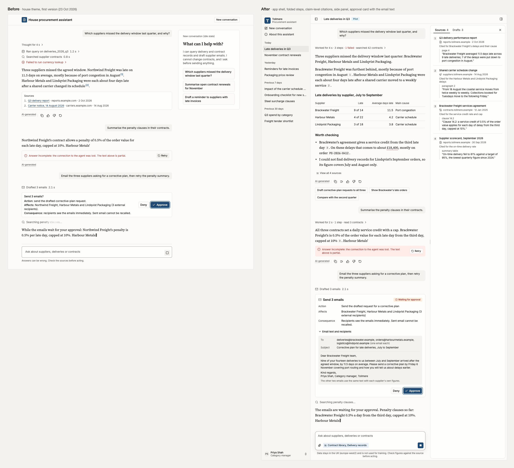

# House theme: rendered check, 23 October 2026 (second version)

These images show the house theme from [`skills/adk-frontend-integration/assets/design/DESIGN.md`](../../../skills/adk-frontend-integration/assets/design/DESIGN.md) rendered in a real shadcn/ui (Base UI) app. This second version adds the app shell, an empty-state screen, the redesigned conversation patterns and the tinted status surfaces, following [premium AI product UI](../../research/premium-ai-product-ui-2026-10-23.md), [user expectations](../../research/ai-ui-user-expectations-2026-10-23.md) (which wins where the two conflict), [frontend craft](../../research/frontend-craft-2026-10-23.md) and [demo readiness](../../research/demo-ready-poc-2026-10-23.md). The checks behind the images: no horizontal overflow, and zero axe violations of any impact at every size, in light and dark, with axe's `target-size` rule switched on.



## What the images are

| File | Content |
|---|---|
| `house-design-system-{375,768,1280}-{light,dark}.png` | Design-system page: colour roles, the new `*-subtle` status surfaces, type scale, radius and elevation (6, 8 and 12 px), buttons, inputs, badges and cards, answer formatting (headings, lists, inline code, a code block with Copy), and a **Patterns** section: shell (a static miniature), empty state, folded turn (expanded), citation preview, approval card, incomplete answer, composer (Send and Stop) and side panel |
| `house-empty-state-{375,768,1280}-{light,dark}.png` | New-conversation screen inside the shell: serif greeting, the can-and-cannot line, the composer with its data line, and a 2 × 2 grid of suggestions |
| `house-conversation-{375,768,1280}-{light,dark}.png` | Conversation screen inside the shell. Parts:<br>• sidebar with date-grouped history (9 seeded conversations), workspace slot and user (expanded at 1280, icon rail at 768, a closed sheet at 375)<br>• header with title, "Pilot" environment badge and side-panel toggle<br>• turn 1: folded steps ("Worked for 4 s · 3 steps · 1 failed · searched 42 contracts"), an answer-first reply with claim-level citation chips, a table in tabular figures, a "check before use" figure, an honest "I could not find…", "View all 4 sources", per-answer actions (Copy, Copy with sources, thumbs, Retry) and follow-up chips<br>• turn 2: a partial answer with the unbordered incomplete notice and Retry<br>• turn 3 (with the 150 ms entrance): running steps visible, the approval card with the email text open and keyboard focus on Approve, a streaming answer with a caret<br>• the floating two-row composer with Stop, the sources toggle and the data line<br>• at 1280 only: the resizable side panel open on Sources (`?panel=sources`) |
| `before-after-1280-light.png` | The first version's conversation screen (left) against this one (right), both 1280 px light |
| `comparison-1280-light.png` | Regenerated for this version: the conversation screen (1280 px, light, side panel open) in the house theme on the left, and the same markup on the right with shadcn 4.22.1's stock theme. The stock side uses the default `neutral` tokens, Geist and the unedited stock component files |
| `brand-<slug>-conversation-1280-light.png`, `brand-<slug>-empty-1280-dark.png` | The four fictional demo brands from `skills/adk-frontend-integration/assets/design/brands/` (`kelderwick-bank`, `marrowby`, `veldmark-industrial`, `avenhale-health`), each applied with `brand_to_preview.py`. Each brand has its own workspace name, `.example` domain, user, greeting, history titles and suggestion cards. The conversation itself is the house procurement story for all four. Every screen says "Fictional company" in the header and in the line under the composer. Each brand imports its serif's `wght.css` |
| `brands-overview.png` | The house conversation screen and the four brand conversation screens side by side at 35% |

Images are 1× PNGs, reduced to 256 colours with Pillow 9.2.0 (median cut, no dither) after a visual check of text edges. Conversation images are as tall as the thread (2221–2972 px); the design-system images are full height (7103–10520 px). The 29 images total 4.9 MB.

## Versions

| Package | Version |
|---|---|
| shadcn CLI | 4.22.1 (`base-nova`, base colour `neutral`) |
| @base-ui/react | 1.9.0 |
| react, react-dom | 19.3.1 |
| react-resizable-panels | 4.14.8 (installed by the `resizable` item) |
| vite | 8.3.5 (@vitejs/plugin-react 6.1.2) |
| tailwindcss, @tailwindcss/vite | 4.3.3 |
| typescript | 6.0.3 |
| tw-animate-css | 1.4.0 |
| lucide-react | 1.61.0 |
| cn | 0.5.0 (shadcn's own package, imported by the components) |
| @fontsource-variable/inter | 5.3.0 |
| @fontsource-variable/source-serif-4 | 5.3.1 (`wght.css`; was `opsz.css`) |
| @fontsource-variable/jetbrains-mono | 5.3.0 |
| playwright | 1.64.1 with `channel: "chrome"` (Google Chrome 155.0.8059.86, headless) |
| @axe-core/playwright, axe-core | 4.14.0 |
| @google/design.md | 0.4.0 |
| Node | 22.23.2 |

shadcn components used: sidebar, sheet, resizable, tabs, hover-card, dropdown-menu, avatar, badge, button, collapsible, input, textarea, label, separator, skeleton (installed with sidebar), tooltip, popover and trace. Hand-built from tokens: the composer, citation chip and passage preview, check-before-use mark, folded-steps line, approval card layout, incomplete notice, side-panel content, suggestion cards and the shell miniature.

## How it was produced

The preview app lives in a scratch directory and is not part of the repository. It is the first version's app, copied without `node_modules` and moved forward.

1. Add the new components to the existing app:

   ```
   npx -y shadcn@4.22.1 add sidebar sheet hover-card resizable tabs avatar skeleton dropdown-menu -y --overwrite
   ```

2. Edit the stock component classes to DESIGN.md's rules in the component files themselves (the first version only overrode them in CSS): button hover to `primary-hover` and press to `primary-active`, no `translate-y-px` and no `transition-all`; badges `rounded-sm`; `TraceDescription`, `SidebarGroupLabel` and `TabsTrigger` text at full `muted-foreground`; `ring-ring/50` focus shadows removed in favour of the house outline; `dark:` colour overrides removed from button, badge, tabs, input and textarea; sidebar easing `ease-out`; the sheet scrim set to the light `foreground` at 40% with no blur.
3. Generate the theme CSS from the DESIGN.md front matter with a scratch script (`gen_theme.py`). It maps each colour token to its shadcn variable, writes the fonts, the radius pins (now including `--radius-2xl: 12px`), the `type-*` utilities, flat shadows, the focus outline and reduced-motion rules, and recomputes 224 contrast pairs, including every new `*-subtle` pair. Fonts and radius steps go in a plain `@theme static` block so a brand can override them at run time. Conversation patterns (composer shadow and focus, scroll fade, answer prose, turn entrance, theme-switch rule, dark-mode shadow removal) are in a separate hand-written `house-patterns.css`.
4. Add the no-flash theme script and `<meta name="color-scheme" content="light dark">` plus `theme-color` metas to `index.html`. Each screen is a lazy route chunk, so the build gives no chunk-size warning.
5. Build, serve and render:

   ```
   npx tsc -b && npx vite build && npx vite preview --port 4318
   node render.mjs http://localhost:4318 <out> results.json
   ```

   For each screen, mode and width, `render.mjs` does the following:
   - Sets `colorScheme`, `en-GB` locale and the `Europe/London` time zone, waits for `document.fonts.ready` and 400 ms for the turn entrance.
   - Presses Tab, focuses the sample control (Focused button, Approve, or the composer) and records its computed outline.
   - Checks horizontal overflow on the document, the thread scroller and the sidebar inset.
   - Runs `new AxeBuilder({ page }).options({ rules: { "target-size": { enabled: true } } }).withTags(["wcag2a","wcag2aa","wcag21a","wcag21aa","wcag22aa"])`, and confirms that `target-size` ran.
   - Grows the viewport until the whole thread fits (the shell scrolls inside the thread, not the page), then captures the viewport.
   - Then two extra checks: with the app's JavaScript blocked, the inline script alone must set the theme from the OS setting; and under `reducedMotion: "reduce"` the new turn must not translate.

6. Compose `before-after-1280-light.png` from a local HTML page holding the saved first-version image and the new one, then reduce all images to 256 colours.

Lint: `npx -y @google/design.md@0.4.0 lint skills/adk-frontend-integration/assets/design/DESIGN.md` gave 0 errors, 0 warnings and 1 info ("82 colors, 11 typography scales, 5 rounding levels, 13 spacing tokens, 94 components"). The scratch contrast script found no pair below its floor; the smallest margins were `warning` on `sidebar-accent` (5.06:1, light, 4.5 floor) and `input` on `accent` (3.13:1, dark, 3.0 floor). Every colour is inside the sRGB gamut. `scripts/check_theme.py --css` on the generated theme found no stock tokens. The skill's 79 unit tests pass on Python 3.13, and `scripts/apply_brand.py --dry-run` exits 0 for all four shipped brands against the updated DESIGN.md.

## Results

Axe counts are violating nodes by impact (critical / serious / moderate / minor); `target-size` ran on every page.

| Image | Overflow | Axe | Axe incomplete | Focus visible |
|---|---|---|---|---|
| house-design-system-375-light / dark | none | 0 / 0 / 0 / 0 | color-contrast: 8 | yes, 2 px `ring` outline |
| house-design-system-768-light / dark | none | 0 / 0 / 0 / 0 | color-contrast: 6 | yes |
| house-design-system-1280-light / dark | none | 0 / 0 / 0 / 0 | color-contrast: 6 | yes |
| house-empty-state-375-light / dark | none | 0 / 0 / 0 / 0 | none | yes (composer card) |
| house-empty-state-768-light / dark | none | 0 / 0 / 0 / 0 | none | yes |
| house-empty-state-1280-light / dark | none | 0 / 0 / 0 / 0 | none | yes |
| house-conversation-375-light / dark | none | 0 / 0 / 0 / 0 | color-contrast: 1 | yes (Approve) |
| house-conversation-768-light / dark | none | 0 / 0 / 0 / 0 | color-contrast: 1 | yes |
| house-conversation-1280-light / dark | none | 0 / 0 / 0 / 0 | color-contrast: 2 | yes |

- **Incomplete items.** These are places where axe could not measure the background: the tab count sits over the active tab's underline pseudo-element; side-panel rows sit in their own scroll region; and on the conversation screen, text is partly under the floating composer. The tokens behind each pair are in the contrast table and pass.
- **First run.** Before a fix, the account button in the sidebar footer failed `label-content-name-mismatch` (serious): its `aria-label` did not contain its visible name. The label was removed and the visible text now names it.
- **No flash.** With the app's JavaScript blocked, `colorScheme: "dark"` gave `<html class="dark">`, `color-scheme: dark` and a body background of `oklch(0.185 0.004 85)`; light gave the light values.
- **Reduced motion.** The new turn used the fade-only keyframes (`turn-fade`, 1 ms under the global rule) and no transform.
- **Console errors.** None on any page.

### Demo brands

Each brand was built and rendered on its own (`JOBS="chat:light:1280,empty:dark:1280" PREFIX=brand-<slug> SKIP_EXTRA=1 node render.mjs …`), with the same axe tags and `target-size` switched on.

| Brand | Image | Overflow | Axe | Axe incomplete | Focus | Fonts loaded |
|---|---|---|---|---|---|---|
| Kelderwick Bank | conversation 1280 light | none | 0 / 0 / 0 / 0 | color-contrast: 2 | 2 px outline, `oklch(0.5 0.12 350)` | Instrument Sans, Newsreader, JetBrains Mono |
| Kelderwick Bank | empty 1280 dark | none | 0 / 0 / 0 / 0 | none | `oklch(0.74 0.1 350)` | Instrument Sans, Newsreader |
| Marrowby | conversation 1280 light | none | 0 / 0 / 0 / 0 | color-contrast: 2 | `oklch(0.5 0.1 120)` | Figtree, Fraunces, JetBrains Mono |
| Marrowby | empty 1280 dark | none | 0 / 0 / 0 / 0 | none | `oklch(0.76 0.105 120)` | Figtree, Fraunces |
| Veldmark Industrial | conversation 1280 light | none | 0 / 0 / 0 / 0 | color-contrast: 2 | `oklch(0.5 0.082 192)` | Geologica, Source Serif 4, JetBrains Mono |
| Veldmark Industrial | empty 1280 dark | none | 0 / 0 / 0 / 0 | none | `oklch(0.74 0.08 192)` | Geologica, Source Serif 4 |
| Avenhale Health | conversation 1280 light | none | 0 / 0 / 0 / 0 | color-contrast: 2 | `oklch(0.5 0.16 266)` | Atkinson Hyperlegible Next, Literata, JetBrains Mono |
| Avenhale Health | empty 1280 dark | none | 0 / 0 / 0 / 0 | none | `oklch(0.72 0.13 262)` | Atkinson Hyperlegible Next, Literata |

The incomplete items are the same two as in the house render (the tab count over the tab underline, and side-panel text in its scroll region). No console errors. Avenhale's cobalt reads as blue, not violet: the light primary is #26449D, with green above red, and the dark step #7CA7F6 reads as cornflower blue.

### House against stock

The regenerated `comparison-1280-light.png` uses the current markup. The stock side keeps the pattern stylesheet (`house-patterns.css`: prose, composer, fade and entrance rules written in token names), so only the tokens, fonts and component files differ.

| Render | Overflow | Axe (critical / serious / moderate / minor) | Focus on Approve | Fonts |
|---|---|---|---|---|
| House | none | 0 / 0 / 0 / 0 | 2 px solid outline, `oklch(0.5 0.1 250)`, 2 px offset | Inter, Source Serif 4, JetBrains Mono |
| Stock shadcn 4.22.1 | none | **0 / 4 / 0 / 0** | no outline; a 3 px box-shadow ring in `oklab(0.708 0 0 / 0.5)` | Geist |

- **Stock contrast failures.** All four serious nodes are stock `muted-foreground` (#737373) on `muted` (#F5F5F5) at 4.34:1 in the approval card's email preview: the "To" and "Subject" labels, "(one email each)" and the closing note. The house pair measures 6.1:1.
- **What the stock side loses.** The house-only tokens do not exist there, so the "Pilot" and "Waiting for approval" badges and the incomplete-answer notice lose their tinted surfaces, and the check-before-use underline loses its warning colour. The brand mark draws in the stock near-black primary. Answers fall back to Geist, because the stock theme has no serif.
- Axe also marked 6 colour-contrast items incomplete on the stock render.

## Applying a brand in the preview

The preview reads one brand file, `src/brand/brand.json` (name, product, the reserved `.example` domain used for source hosts, accent-ramp colours, font stacks, control radius, logo file names). Beside it are `fonts.css` (the `@fontsource-variable` imports) and `logo.svg` and `mark.svg`, which are inlined so a mark drawn in `var(--primary)` follows light and dark mode. `applyBrand()` refuses any colour outside the DESIGN.md brand override, sets the `sidebar-primary*` and `sidebar-ring` followers, and accepts 4 px, 6 px (the house value) or 8 px for the radius, as `apply_brand.py` does. The scratch converter `brand_to_preview.py <brands/slug> <preview/src/brand> [--content <file>.json]` writes these files from a `brand.yaml` and prints the font packages to install. It sets the domain from the brand's first word (`kelderwick.example`), copies `fictional: true` (which adds "Fictional company" to the header and the line under the composer; the label never says "demo" or "test"), and writes `content.json`: the sample user, history titles and suggestion cards. `{}` keeps the house sample. The four brand renders above came from this path: one copy of the preview with all seven brand font packages installed, the converter, then `npx vite build --outDir ../dist-<slug>` per brand.

## Not verified

- **Visual judgement.**
  - The screenshots were looked at by an agent, not reviewed by a designer or shown to clients.
  - No other browsers were tried (Firefox, Safari), and no device pixel ratio other than 1. Decks need 2× captures, which these are not.
  - Forced-colours mode and Windows font rendering were not tried.
- **Interaction.**
  - Hover cards, tooltips, menus and the mobile sheets were not opened in the captures. The citation preview is shown as a static card on the design-system page. The sidebar sheet at 375 px and the side-panel sheet below 1024 px were not rendered open.
  - Resizing the side panel by pointer or keyboard, collapsing the sidebar, and the URL update on toggling the panel were not exercised by a test.
  - Enter, Shift+Enter and IME composition in the composer, Stop, follow-up chips, Copy and Copy with sources have no behaviour in the preview. DESIGN.md states the rules, but nothing here tests them.
  - Scroll-following and shadcn's `message-scroller` were not used; the thread is static.
  - On touch, the citation chip should open a popover rather than a hover card. That was not built.
  - No screen-reader run was done. Live-region announcements, the hidden "check before use" text and the summary-line commas are untested with VoiceOver or NVDA.
- **Content.**
  - Tollmere, Brackwater Freight and the other names were checked only against the toolkit's own notes, not in a trademark search.
  - The data line ("europe-west2", not used for training) is fictional demo copy.
- **Brands.**
  - Each brand was rendered only as the conversation screen at 1280 light and the empty state at 1280 dark: not at 375 or 768, not the design-system page, and not the other mode.
  - The brand screens show the house procurement conversation, with Brackwater Freight and the same sources and email, inside the brand's own shell. Only the history titles, suggestions, user and greeting fit each industry.
  - The "Fictional company" note in the header is hidden below 768 px. On narrow screens only the line under the composer carries it, and that was not rendered.
  - The brand images were judged by an agent at full size and in the 35% overview. No designer or client has looked at them.
- **Stock comparison.** The stock side keeps the house pattern stylesheet and the house markup, including classes for house-only tokens. It shows what the tokens, fonts and component files change, not how a stock shadcn chat app would look.
- **Quantised images.** The 256-colour images were checked by eye on a few crops only; contrast results come from the live page, not the images.
